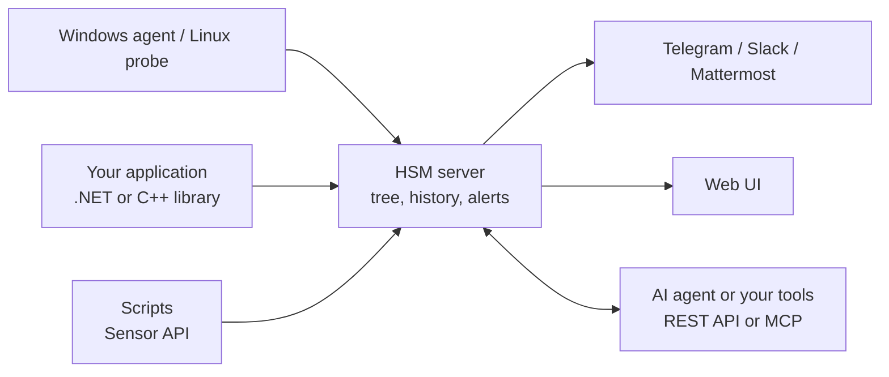
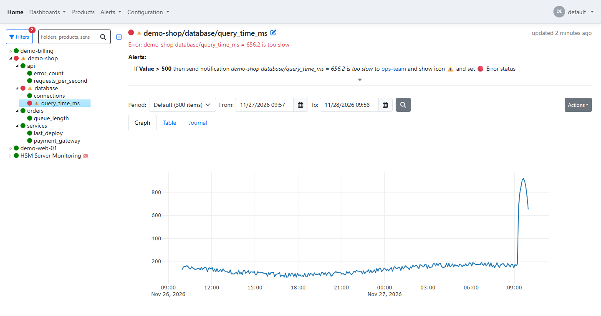
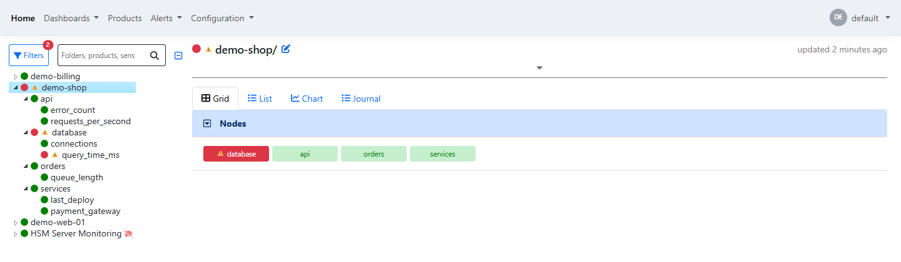

# HSM: self-hosted monitoring for your applications and machines


**HSM (Hierarchical Sensor Monitoring) is a monitoring server that you run yourself.** Your
applications and machines send values to it over HTTPS. HSM keeps their history as a tree of
sensors and shows it in a web UI. When a value crosses your rule or stops arriving, HSM sends a
message to Telegram, Slack or Mattermost. An AI agent can set HSM up and manage it through the
REST API or the built-in MCP server.

To try it, [let your AI agent set it up](#set-it-up-with-your-ai-agent) or follow the
[quick start by hand](#quick-start-by-hand).

## How it works

1. A source sends a value to a path such as `database/query_time_ms`, signed with an access key.
2. HSM creates the sensor on the first value and stores every value after that.
3. HSM checks the sensor's alert rules on each value, and watches for silence.
4. When a rule fires, HSM sends a message to the chats you chose.
5. You, your scripts or your AI agent read the current state and history.



| Term | Meaning |
|---|---|
| Product | A container for one application, service or machine, with its own access keys |
| Sensor | One stream of values, identified by its path inside a product |
| Access key | The credential a source uses to send data to one product |
| API token | The personal credential your scripts and AI agent use to manage HSM, over the REST API and MCP. Created under **Personal tokens** |
| Alert | A rule on a sensor: a condition, and where to send the message |

## Ways to send data

| Source | Use it when | You need |
|---|---|---|
| HSM Agent | You want CPU, memory, disk and network of a Windows machine | Administrator rights on that machine |
| HSM Linux probe | You want the same for a Debian host | root on that host |
| [HSMDataCollector](https://github.com/SoftFx/Hierarchical-Sensor-Monitoring/wiki/HSMDataCollector) | Your .NET application reports its own metrics | .NET 6 or .NET Framework 4.7.2 |
| [Native collector](https://github.com/SoftFx/Hierarchical-Sensor-Monitoring/tree/master/src/native/collector) | Your C++ application reports its own metrics | C++17; the `hsm-collector` vcpkg port |
| [Sensor API](https://github.com/SoftFx/Hierarchical-Sensor-Monitoring/wiki/REST-API) | Anything that can make an HTTPS request | An access key |

The Windows agent and the Linux probe come as a ready bundle that already holds the product's
access key: download it under **Configuration → Downloads**, or let your AI agent get a one-time
link.

The .NET package is `HSMDataCollector.HSMDataCollector`:

```bash
dotnet add package HSMDataCollector.HSMDataCollector
```

## Screenshots

A sensor with a day of history. Its rule fired when the value went above 500.



A product at a glance. The error of one sensor is visible on its folder and its product.



## Why HSM

- **You learn about silence first.** A service that stops reporting raises an alert, not only a
  number that is too high.
- **Your application sends its own numbers:** queue length, last error, connection status. The .NET
  and C++ libraries queue values and send them in batches.
- **The data stays with you.** HSM runs on your own server.
- **The structure is yours.** The path you send is the tree you see.
- **Alerts fit your working day.** Schedules, confirmation periods and templates for many sensors.
- **Scripts and AI agents can do the work.** Ask your agent what happened last night: it reads the
  history through MCP or the REST API.

**Look elsewhere if**

- You want a hosted service. HSM has no cloud offering.
- You need alerts by email, SMS or a paging service. HSM sends messages only to Telegram, Slack and
  Mattermost.
- You need log search or distributed tracing. HSM stores sensor values and files.
- You need a cluster with failover. HSM runs as one server with an embedded database.
- Your sources can only be scraped (pull model). HSM waits for them to send.

## What your AI agent can do

HSM operations work over the REST API and over MCP, with the same API token. The agent can do
what the token's owner can do. Installing needs shell access, and sending values uses an access key.

| Area | The agent can |
|---|---|
| Install | Deploy the server with Docker Compose, given shell access to the host |
| Products | List products, create a product |
| Access keys | Create, rename, change permissions, block, delete |
| Sources | Get a one-time link to the Windows agent or Linux probe installer; add a collector library to your code; send values |
| Reading data | Browse the tree and folders, search sensors by name or type, read current values and history, download large files such as crash dumps |
| Alerts | Rules on values and on silence per sensor; alert templates for many sensors; working-time schedules; mute and unmute |
| Chats | Create, change and delete chats; send a test message; issue a Telegram invitation |
| Telegram bot | Read its status, set its token, switch delivery on and off |
| Tree upkeep | Move and rename sensors, merge histories, remove old paths, delete sensors |
| Audit | Read the journal of configuration changes and roll changes back |

Deleting and moving sensors, and deleting chats, can be previewed first (dry run). Creating chats
and schedules and setting the bot need an administrator's token. Silence rules for a whole product
or a node inside it are set through the REST API only.

**Only you, in the web UI:**

- the first sign-in and the new password;
- creating and revoking API tokens;
- users and their roles;
- folders, product settings and product removal;
- dashboards, server settings, backups and restore.

To connect a Telegram chat, a person also opens the invitation and presses Start.

## Status and limitations

| Component | State |
|---|---|
| HSM server | Released, 3.x |
| HSMDataCollector (.NET) | Stable 4.0; newer versions are previews (table sensors, large files) |
| HSM Agent (Windows) | Released, before 1.0 |
| HSM Linux probe | Released, before 1.0 |

Current versions: [releases](https://github.com/SoftFx/Hierarchical-Sensor-Monitoring/releases).

- One server instance. There is no clustering.
- The default administrator password is not forced to change.
- API tokens can be created only in the web UI.
- The Windows agent collects standard host sensors only. It has no plugins.
- The Linux probe is built for Debian.
- New products keep history for 3 months by default.

## Technical facts

| | |
|---|---|
| Runs as | Docker Compose: `hsmonitoring/hierarchical_sensor_monitoring` behind a Caddy image |
| Ports | 443 for everything; 80 for redirect and certificate issuance |
| Sending data | Sensor API (REST): `/api/sensors/...`, header `Key: <ACCESS_KEY>` |
| Managing HSM | Management API (REST): `/api/v1`, reference at `/api/swagger`. MCP server: `/mcp`. Both take `Authorization: Bearer <PERSONAL_TOKEN>` |
| Storage | Embedded database in the `Databases` folder next to the compose file |

## Security

- **Change the default password first.** A new server has the administrator `default` with the
  password `default`. HSM does not force you to change it. Do it before anyone else can reach the
  server.
- **HTTPS only.** Caddy obtains a Let's Encrypt certificate, or uses a self-signed or your own one.
- **Access keys are limited to a product.** Each key has its own permissions and can be blocked.
- **Roles per product:** Viewer and Manager, plus server administrators.
- **Single sign-on** with OpenID Connect is optional.
- **An API token has all the rights of its owner** over the REST API and MCP, including deleting
  data. For daily work, use the token of a user who has roles only on the products needed.
- **A read-only token** can read through the REST API. It cannot change anything or connect to MCP.

## Set it up with your AI agent

Paste this to any agent that can read web pages and run commands:

```text
Set up HSM monitoring for me: https://github.com/SoftFx/Hierarchical-Sensor-Monitoring
Follow https://raw.githubusercontent.com/SoftFx/Hierarchical-Sensor-Monitoring/master/AGENT-SETUP.md
Ask me what you need before you change anything.
```

The agent installs the server and connects your sources. You change the default password, create
one API token and confirm the notification chat.

## Quick start by hand

You need a host with Docker Compose 2.23.1 or newer, free ports 80 and 443, and a host name that
points to it.

**1. Download the compose file and the settings template.**

```bash
curl -O https://raw.githubusercontent.com/SoftFx/Hierarchical-Sensor-Monitoring/master/docker-compose.yml
curl -o .env https://raw.githubusercontent.com/SoftFx/Hierarchical-Sensor-Monitoring/master/.env.example
```

**2. Edit `.env`.** For a public host name with ports 80 and 443 open:

```ini
HSM_DOMAIN=hsm.example.com
HSM_CERTIFICATE=letsencrypt-http
```

Other certificate modes: [Installation](https://github.com/SoftFx/Hierarchical-Sensor-Monitoring/wiki/Installation).

**3. Start the server.** The first start can take several minutes.

```bash
docker compose up -d
```

**4. Sign in** at `https://<HSM_DOMAIN>` as `default` / `default`. Open **Configuration → Users**,
edit the user `default` and set a new password of 8 characters or more.

**5. Create a product** on the **Products** page (**Add product**). Copy its access key from
**Configuration → Access keys**.

**6. Send a value.**

```bash
curl -X POST https://<HSM_DOMAIN>/api/sensors/double -H "Key: <ACCESS_KEY>" -H "Content-Type: application/json" -d '{"path":"demo/temperature","value":21.5}'
```

A `200` response means HSM accepted it. The sensor `demo/temperature` appears in your product.

**7. Add an alert** on the sensor, and connect a chat to receive it:
[Alerts](https://github.com/SoftFx/Hierarchical-Sensor-Monitoring/wiki/Alerts-Overview),
[Telegram setup](https://github.com/SoftFx/Hierarchical-Sensor-Monitoring/wiki/Telegram-Setup).

## Documentation

| I want to | Page |
|---|---|
| Let an AI agent set it up | [AGENT-SETUP.md](https://raw.githubusercontent.com/SoftFx/Hierarchical-Sensor-Monitoring/master/AGENT-SETUP.md) |
| Install and update the server | [Installation](https://github.com/SoftFx/Hierarchical-Sensor-Monitoring/wiki/Installation) |
| Configure the server | [Server configuration](https://github.com/SoftFx/Hierarchical-Sensor-Monitoring/wiki/Server-Configuration) |
| Use the web UI | [Using the HSM site](https://github.com/SoftFx/Hierarchical-Sensor-Monitoring/wiki/Using-HSM-Site) |
| Manage HSM from code | `https://<HSM_DOMAIN>/api/swagger` on your server |
| Connect an AI agent over MCP | [MCP](https://github.com/SoftFx/Hierarchical-Sensor-Monitoring/wiki/MCP) |
| Send data over HTTP | [Sensor API](https://github.com/SoftFx/Hierarchical-Sensor-Monitoring/wiki/REST-API) |
| Set up alerts | [Alerts](https://github.com/SoftFx/Hierarchical-Sensor-Monitoring/wiki/Alerts-Overview) |
| Read all documentation | [HSM wiki](https://github.com/SoftFx/Hierarchical-Sensor-Monitoring/wiki) |
| Connect Grafana | [Grafana](https://github.com/SoftFx/Hierarchical-Sensor-Monitoring/wiki/Integration-with-Grafana) |

## Repository

```text
src/server/       HSM server (ASP.NET Core 8)
src/api/          data contracts shared by the server and the .NET library
src/database/     history storage
src/collector/    HSMDataCollector, the .NET library
src/native/       native C++ collector
src/agent/        Windows agent
src/probe-linux/  Linux probe
aicontext/        behavior documentation, written for AI agents and developers
```

Found a problem? [Open an issue](https://github.com/SoftFx/Hierarchical-Sensor-Monitoring/issues).
