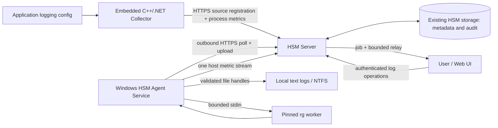

# HSM: архитектура доступа к логам со сменным backend

**Статус:** Proposal / готово к техническому обсуждению, не описание реализованной функции.
**Версия документа:** 1.2, 22 октября 2026.
**Репозиторий:** [SoftFx/Hierarchical-Sensor-Monitoring](https://github.com/SoftFx/Hierarchical-Sensor-Monitoring).
**Область:** Windows Agent, embedded C++/.NET Collectors, HSM Server, Web UI.
**Решение:** единый HSM Log Access API обращается к логическим источникам через сменные providers. Первая реализация читает локальные текстовые логи отдельным Windows Agent; дальнейшее подключение log database сохраняет внешний контракт.

## 1. Резюме решения

HSM Agent работает как отдельная Windows Service и владеет host-level monitoring: CPU/RAM компьютера, диски, сеть и другие общие OS-метрики. Embedded HSM Collectors собирают process/business monitoring своего приложения. Включение host sensors в каждом embedded collector прекращается в новом профиле конфигурации. Один агент обслуживает все приложения на машине.

В первой реализации приложение остаётся владельцем конфигурации логирования, ротации и удаления файлов. Collector регистрирует **метаданные log source** на HSM Server при старте и после изменения фактического пути. Сервер хранит долговечный реестр, версии путей и permissions в существующем HSM storage. Agent получает разрешённые descriptors от сервера, проверяет их против локальной политики и сохраняет локальный кэш. Работа приложения не требуется для последующего поиска и скачивания.

Пользователь выбирает логический source и при необходимости объекты логов в HSM UI, выполняет поиск с контекстом или выгрузку. Сервер авторизует действие и передаёт его выбранному provider. В первой реализации Agent перечисляет разрешённые файлы, запускает закреплённый `rg.exe` или читает файл потоком с gzip-компрессией на лету. Сервер проксирует ограниченный поток с backpressure. В первой реализации постоянной загрузки логов, индекса и отдельной базы логов нет; NTFS compression применяется как локальная эксплуатационная политика.

Доступ сохраняется после остановки приложения, если source зарегистрирован, данные сохранены и provider доступен. Для файловой реализации нужны сохранившиеся файлы, работающие host/Agent и разрешающие ACL; после перезапуска Agent/Server доступ восстанавливается без приложения. Эта реализация не восстанавливает удалённые файлы и не читает выключенный host. Центральный provider в будущем сможет обслуживать сохранённые данные независимо от доступности исходного host.

**Долгосрочная цель — неизменность внешнего интерфейса при замене backend.** Текстовые файлы + rg являются первой реализацией доступа к логам. Переход к полноценному хранилищу, log database или смешанной схеме должен сохранять тот же пользовательский сценарий и публичный API: источники, поиск с контекстом, выбор доступных объектов и потоковая выгрузка. Хранение, индексация, маршрутизация, объединение и устранение дублей скрываются за внутренним provider-контрактом Server (§4.1). Ограничение «без отдельной log DB» относится к первой реализации, а не к неизменяемой границе архитектуры.

## 2. Основания, исследование и ограничения достоверности

### 2.1 Проверенная база

Основное исследование выполнено по указанной локальной копии:

`C:\project\githubSoftFx\Hierarchical-Sensor-Monitoring`

На момент чтения `.git/HEAD` указывал на `feature/1572-1574-probe-io-names`, файл ref — на **`728a7d84018e33e51c2bc3e83c077fec64a27a8e`**. Это базовый commit для ссылок ниже; прочитанные рабочие файлы могут содержать локальные изменения. Полный статус рабочей копии не подтверждён: доступ к ней через `git -C` ограничен средой, обычное чтение исходников доступно. Дополнительно скачана публичная default branch `master`, HEAD **`a89ffb73795c2dc1f20645a85180fa8368cb696b`**. Локальная ветка и публичный master не считаются идентичными.

Прочитаны `AGENTS.md`, `CLAUDE.md`, компонентные инструкции и выбранные исходники. Сборка и runtime-тесты в рамках подготовки документа не запускались. Проверка наличия/отсутствия функций — исследование исходников, не аудит всего продукта. Имена новых классов и маршрутов ниже являются предложениями.

Из предыдущего разговора получены пользовательские сообщения: динамические пути, дублирование host sensors, необходимость доступа после падения сервиса. Тексты ответов ассистента в доступной истории представлены ссылочными маркерами; они не восстановлены и не используются как доказательство. Архитектурные решения опираются на явное текущее задание.

### 2.2 Current vs proposal

Для таблицы база ссылок: [локальный базовый commit](https://github.com/SoftFx/Hierarchical-Sensor-Monitoring/tree/728a7d84018e33e51c2bc3e83c077fec64a27a8e).

| Поверхность | Current: подтверждённое состояние | Proposal / точка расширения |
|---|---|---|
| Agent | `src/agent/` — существующий native C++ Agent, standalone monitoring и service lifecycle | Развивать существующий Agent; добавить log subsystem, не создавать второй агент |
| .NET Collector | `src/collector/HSMDataCollector/Core/DataCollector.cs`, `Options/CollectorOptions.cs`; net6.0/net472, версия 3.6.1 | Additive log-source capability и process-only profile |
| Host sensors | `PublicAPI/IWindowsCollection.cs` содержит `AddAllDefaultSensors`, `AddTotalCpu`, `AddFreeRamMemory`, disk/network/top-process APIs | Явно классифицировать host/process; host acquisition только у Agent |
| Native Collector | `src/native/collector/` — отдельная native реализация со stable C ABI; `src/wrapper/` — legacy facade | Эквивалентные source registration и profile APIs без нарушения ABI |
| File sensors | `Sensors/InstantSensors/FileSensorInstant.cs`: читает файл целиком в byte array; `FileSensorValue` отправляется серверу | Не использовать этот pipeline для многогигабайтных логов |
| Ingest | `Client/HttpsClient/Endpoints.cs`, `HsmHttpsClient.cs`: `api/sensors/*`, заголовки `Key`/`ClientName` | Отдельный control/data plane log access; сохранить старые endpoints |
| Commands | `src/api/HSMSensorDataObjects/CommandRequestBase.cs`: `Command.AddOrUpdateSensor`; `SensorsController.cs` — `POST api/sensors/commands` | Это не готовый универсальный server→Agent RPC; новый typed job protocol |
| Server | `src/server/HSMServer/HSMServer.csproj`: net8.0, версия 3.41.7 | Тонкие controllers, policy/routing в services/Core |
| Agent distribution | `Controllers/AgentController.cs`, `Model/Agent/AgentInstallerBundle.cs`, `AgentConnectionResolver.cs` | Дополнить installer enrollment/config/capabilities; не путать installer API с job transport |
| Legacy access keys | `HSMServer.Core/Model/AccessKeyModel.cs`: `CanSendSensorData`, `CanAddNodes`, `CanAddSensors`, `CanReadSensorData` | Ни одно из этих прав автоматически не даёт право читать локальный лог |
| Management auth | `Authentication/ApiTokenAuthorizationService.cs`, `ApiTokenResource.cs`: проверки текущих прав владельца и product/folder boundary | Дополнить отдельными log permissions; существующие read-only tokens не получают log access автоматически |
| Storage | `src/database/HSMDatabase.AccessManager/`, `DatabaseEntities/`, `IEntityDatabase.cs`; история файлов — `HSMServer.Core/Model/Storages/ValueStorages/FileValuesStorage.cs` | Метаданные в существующем storage; содержимое логов через него не хранить |
| Shared DTO | `src/api/HSMSensorDataObjects/HSMSensorDataObjects.csproj`: netstandard2.0, 3.2.0 | Новые DTO в отдельном namespace, protocol version независимо от package version |

Дополнительные подтверждённые native/Agent детали:

* `src/agent/CMakeLists.txt`: Agent **0.5.45**; `src/native/collector/CMakeLists.txt` и `include/hsm_collector/hsm_collector.h`: native collector **0.11.1**.
* `src/agent/src/agent_runtime.cpp`, `hsm::agent::AgentRuntime`: создаёт native `Collector`, включает HTTP transport/Windows metric sources, запускает monitoring и updater. `include/agent/config.hpp`, `AgentConfig` пока не содержит log-source policy или search/download jobs.
* `src/agent/src/service/service_install.cpp`, `InstallService()`: `CreateServiceW` с null account устанавливает службу под **LocalSystem**. Это конкретная причина выделить ограниченный log worker, прежде чем включать удалённое чтение.
* `src/agent/src/main.cpp`: Global mutex уже есть, но при ошибке создания guard может пропустить запуск. Для нового host ownership требуется fail-closed guard и server fencing; существующий mutex не решает дедупликацию collectors.
* `src/agent/src/paths.cpp`: `%ProgramData%\HSM Agent\config.json`, собственные логи в `logs\hsm-agent.log`. `dir_acl.cpp` защищает agent directories и проверяет некоторые reparse cases; это не готовый confinement произвольных application roots.
* `src/native/collector/src/hsm_http_transport.cpp`, `hsm::http::HttpTransport`: response body накапливается в `std::string`. Новый data plane требует streaming callbacks/отдельного клиента; reuse существующего `Get` не обеспечивает ограниченную память.
* `hsm_collector.h` и `collector.hpp`: есть extra headers/directive callbacks. `AgentRuntime` использует `X-Agent-Version` и `X-Hsm-Directive` для `update-available`, `sensor-enable/disable`. Callback вызывается на send path; допустим только сигнал пробуждения, не исполнение log job.
* `src/native/collector/src/hsm_collector.cpp`: `CalculateSystemPath()` и `.computer`/`.module` plus singleton metadata согласуют sensor paths, но не предотвращают повторный OS acquisition. `AddAllComputerSensors()` включает topCPU самостоятельно; `AddAllModuleSensors()` включает process monitoring. Текущие флаги Agent `top_cpu_enabled=false`/`sensors_process=false` не обязательно исключают соответствующие workers при включённых bundles. Миграция должна проверять фактический состав sensors.
* Native `hsm_sensor_add_file_from_path` читает UTF-8 text целиком с cap 10 MiB. Это публикация FileSensor value, а не remote file access. `src/agent/src/update_checker.cpp` проверяет SHA-256 загруженного exe; hash сам по себе не доказывает publisher authenticity — подписанный release/доверенная доставка являются требованием proposal.

Некоторые overview-документы расходятся с исходниками: встречаются static scheduler и net8 collector; фактические `CollectorOptions`, проект и актуальная collector overview подтверждают per-instance lifecycle и net6.0/net472. При реализации ориентироваться на код и исправить затронутые canonical docs.

### 2.3 Что требуется подтвердить до реализации

Инвентарь Windows версий и архитектур, масштабы и кодировки логов, модель нескольких products на одном host, допустимая нагрузка дисков, прокси/таймауты, требования к аудиту и retention. Наличие C++ и managed collector не означает одинаковый механизм каждой новой операции: parity должно быть доказано conformance tests.

## 3. Цели, границы и инварианты

### 3.1 Цели

1. Искать literal/regex по текстовому представлению логических объектов с before/after context, независимо от хранения.
2. Перечислять объекты логов и выгружать выбранный объект без полной буферизации и временного архива.
3. Обрабатывать смену пути, ротацию, Unicode, частичные ошибки и отмену.
4. Сохранять реестр источников после смерти процесса; не удалять его по heartbeat TTL.
5. Исключить дублирование host acquisition у новых управляемых deployments.
6. Обеспечить авторизацию по source/product и независимое соблюдение provider-specific границ доступа; для файлов — локальная policy и filesystem ACL.
7. Сохранить существующие sensor APIs, историю и публичную совместимость collectors.
8. Обеспечить замену файлового backend на хранилище/log database без изменения публичных endpoints, обязательных DTO, семантики существующих операций, SDK-вызовов потребителя и пользовательского сценария. Особенности backend не должны становиться обязательными параметрами клиента.

### 3.2 Non-goals v1

Центральная индексация и ingest всех логов; VictoriaLogs, LogSonic и иная отдельная log DB; SIEM; универсальная командная оболочка; запись/удаление логов пользователем; распределённый полнотекстовый поиск с сортировкой всех событий по timestamp; tail -f; multiline regex; поиск внутри ZIP/GZ; SMB/UNC источники; Linux log access. Наличие Linux Agent не делает Windows-контракт автоматически переносимым.

### 3.3 Обязательные инварианты

* Log source metadata не содержит содержимого логов, credentials или команд для исполнения.
* Регистрация описывает source и его provider binding, но сама по себе не выдаёт read permission. Для файлового binding путь дополнительно ограничен локальной policy.
* Сервер выбирает provider по доверенному binding; файловый provider выбирает Agent по доверенному `hostId`, не по IP, DNS или имени компьютера из collector payload.
* Приложение не участвует в исполнении search/download и не является proxy.
* Отсутствие heartbeat означает `producerOffline`, а не удаление source.
* Старые пути не теряются при смене активного пути; их доступ подчиняется отдельной retention/policy.
* Любой неполный результат явно помечается; «0 matches» возвращается только для полностью проверенного набора.
* Никакая операция не вызывает shell, пользователь не передаёт rg flags или executable path.
* Измерение host sensors выполняет один активный Agent на host; отображение одной метрики в нескольких product views не создаёт повторных измерений.
* Публичные log-source IDs, permissions, jobs, search results и download tokens принадлежат HSM-контракту, а не конкретному backend. Клиент не выбирает rg, таблицу БД, индекс или алгоритм merge.

## 4. Архитектура и границы ответственности

Диаграмма первой, файловой реализации; публичная граница — Server facade, а Agent/rg находятся за ней:



**Collector:** знает фактические пути, application identity, encoding, file patterns; сообщает изменения. Не даёт Agent instructions исполнять shell и не настраивает ACL самовольно.

**Agent:** знает host identity и локальные policy roots; собирает host metrics, перечисляет/открывает файлы, исполняет ограниченные search jobs, сжимает download stream, ведёт diagnostics и durable metadata cache.

**Server:** authoritative source registry и ACL, enrollment/bindings, liveness, job scheduling/leases, relay, audit. Не открывает пути на собственном диске из collector payload.

**UI:** показывает sources, поколения, объекты, доступность операций, consistency и неполноту; экранирует log text, не интерпретирует HTML/ANSI. Поиск возможен по source без предварительного listing или выбора физического файла. Host/Agent и root diagnostics доступны отдельно уполномоченному оператору файлового provider и не являются обязательными шагами обычного пользователя.

**Прямой Collector↔Agent канал в v1 не нужен.** Обе стороны связаны через Server, `hostId` и source registry. Host binding передаётся приложению при deployment. Это уменьшает локальную IPC attack surface. Будущий pipe-discovery возможен отдельным ADR; не нужен для чтения логов после остановки приложения.

### 4.1 Стабильный фасад доступа к логам и сменные providers

Server предоставляет единый **Log Access Facade**. Controllers, UI и внешние API-клиенты работают только с ним. Внутренний `ILogAccessProvider` (proposal) реализует перечисление логических объектов, поиск с контекстом, открытие export stream и отмену; coordinator сохраняет общие authorization, quotas, job lifecycle, audit и нормализацию ошибок. Provider routing хранится в серверной конфигурации source и не передаётся обязательным полем публичного запроса.

| Слой | Стабильный контракт | Сменная реализация |
|---|---|---|
| Consumer API / UI | Source → search/context или необязательный выбор объектов → export; стабильные endpoints и envelopes | Не зависит от способа хранения |
| Log Access Facade | Identity, permissions, job lifecycle, limits, cancellation, результат и integrity | Выбирает provider и внутреннюю стратегию |
| Provider | List, search, context, export с общими semantics | `AgentFileLogProvider` в v1; будущие `DatabaseLogProvider` / `CompositeLogProvider` |
| Execution / storage | Скрыто от потребителя | Agent + file handles + rg; DB query/index; merge нескольких источников |

Это **новая предлагаемая граница**, не найденная в текущем коде. В первой реализации требуется выделить интерфейс и файловый adapter, но не разрабатывать реальную log DB или универсальный query language заранее.

**Нейтральная модель данных.** `sourceId` идентифицирует логический поток приложения; `generationId` — поколение его конфигурации/coverage, а не физическую папку и не гарантию неизменяемости содержимого. `objectId` — стабильная логическая identity объекта внутри source, сохраняемая при переносе между backends; `viewId` фиксирует представление объекта в пределах job/token. Root path, физическая кодировка и file identity — детали private binding. Listing возвращает `objectId`, opaque `objectToken`, displayName, nullable размер, consistency и доступные операции. В файловом provider объект соответствует файлу, в DB — логическому сегменту с текстовой проекцией. Предлагаемый consumer endpoint — `/objects:query`; прежние названия `/files:query` и `fileToken` не сохраняются: эта log API ещё не реализована и не имеет обязательств backward compatibility. UI использует название «Объекты логов» без обязательного пути или расширения файла.

**Единая семантика поиска и контекста.** Базовый API line-oriented: literal/regex по текстовому представлению, before/after context в пределах объекта, line numbers относительно `viewId` и UTF-8 byte ranges. Семантика закрепляется HSM-профилем `text-v1` и conformance corpus (§8.1), а не названием executable или текущей версией rg. Для DB нужна детерминированная текстовая проекция с закреплённой representation version и порядком записей. Backend adapter обязан сохранить regex/context/case/Unicode semantics; при несовместимости встроенного engine используется совместимый matching layer. Физический mtime не включается в обязательные consumer filters; временной фильтр событий отсутствует в базовом v1, а не переименовывается из файлового фильтра. DB-specific аналитика возможна как additive функция, не замена базового контракта.

**Единая выгрузка.** Базовый download отдаёт representation `text-v1`: UTF-8 без BOM, переносы LF, с явно указанной representation version; checksum считается по этим несжатым export bytes. Оригинальные encoding/CRLF не являются частью общего обязательного контракта. Для DB provider выдаёт то же представление логического объекта. Дополнительная capability `logs.export.original.v1` допускает выгрузку исходных bytes, если они сохранены; UI называет её «Исходные данные», а базовую операцию — «Выгрузить». Миграция не может молча превратить ранее доступный original export в реконструкцию: нужно сохранить originals в новом storage/retained tier до конца согласованного retention либо отдельно утвердить изменение optional capability. Для сохранённых объектов базовый `text-v1` и logical identity не меняются.

**Merge скрыт внутри Server.** При смешанном storage `CompositeLogProvider` делит coverage по поколениям/диапазонам и объединяет результаты в прежнем manifest order, сохраняя context boundaries. Один и тот же перенесённый объект имеет общую logical identity; дубли устраняются по identity и coverage, а не совпадению текста (одинаковые реальные строки могут быть разными событиями). Внутренние DB IDs, shard keys и cursors наружу не выходят. Partial/error summary отражает недоступную часть coverage. Глобальная timestamp-сортировка не появляется неявно при смене backend.

**Миграция без смены интерфейса.** Сначала shadow reads на одинаковом corpus, затем сверка search/context/export и controlled cutover серверного routing. Существующие jobs/tokens привязаны к provider revision до окончания TTL: их либо обслуживает прежняя реализация, либо они завершаются документированным `INTERRUPTED`/expiry, без смешения representation посреди потока. Source IDs и grants не меняются. Rollback переключает routing; данные старого backend удаляются только после проверки coverage и окончания обязательств по оригинальным объектам.

**Две отдельные поверхности.** Consumer API/SDK/UI всегда оперирует логическими sources/objects. Producer и deployment control plane регистрирует физический binding через отдельный versioned descriptor; только там допустимы root, patterns, encoding, DB credentials references и прочие детали подключения. При замене backend может измениться deployment configuration, но не consumer contract. Binding и credentials не возвращаются обычному читателю. Agent control API — внутренний execution protocol файлового provider, не обязательный protocol для DB provider. Поддержка core list/search/context/download обязательна для любого допущенного provider; её отсутствие блокирует cutover, а не требует менять UI или скрывать базовые кнопки.

Доступность определяется выбранным provider: локальному нужны Agent/host, центральному storage может не требоваться работающая машина приложения. Внешний статус отражает доступность операции и общие ошибки, а не заставляет клиента сначала проверять Agent. Публичные capabilities описывают действия (`logs.list.v1`, `logs.search.v1`, `logs.download.gzip.v1`); `rg`, NTFS и DB engine остаются внутренними execution capabilities. Новому provider запрещено ослаблять source permissions, retention commitments, audit или cancellation guarantees.

## 5. Identity и недублирование host sensors

### 5.1 Identity

* `hostId`: UUID, выданный при enrollment; хранится вне папки приложения, переживает rename/restart. Не равен hostname, machine SID или IP.
* `agentId`: installation identity; отдельная credential. `agentEpoch` меняется при каждом запуске.
* `applicationId`: стабильная identity deployment/application, а не PID.
* `collectorInstanceId`: конкретный runtime; используется для диагностики и fencing, не как source key.
* `sourceKey`: постоянное имя источника внутри application, например `orders/main`.
* `sourceId`: серверный UUID для `(productId, hostId, applicationId, sourceKey)`; путь не входит в ключ.

Клонирование VM с enrollment state запрещено: re-enrollment выдаёт новый hostId. Credential binding разрешает Agent обслуживать только свой hostId; collector credential привязана к допустимым host/application/product bindings администратором. Знания hostId недостаточно для регистрации.

### 5.2 Профили мониторинга

Предлагаются `LegacyDefaults`, `ProcessOnly`, `HostAgent`. Существующее поведение `AddAllDefaultSensors` сохраняется для старых потребителей. Новые deployment templates явно выбирают `ProcessOnly`; Agent выбирает `HostAgent`. Добавить отдельные additive методы, не менять смысл существующих скрытно.

| Scope | Единственный владелец | Примеры |
|---|---|---|
| Host | Agent | Total CPU, available RAM, disk space/latency/queue, network interfaces, top processes |
| Process | Embedded collector | Process CPU/memory/threads, managed GC, collector health |
| Business | Embedded collector | Orders, sessions, queues, errors домена |
| Log source | Collector описывает; provider читает (Agent в первой реализации) | Main log, audit log, поколения source |

Внедрение отключает host sensors в каждом приложении явно. Server dedup не экономит acquisition, поэтому не заменяет эту настройку. Автоматически включать host fallback при потере heartbeat Agent запрещено: это создаёт гонки и повторные измерения. Если Agent недоступен, host metrics становятся stale, process metrics продолжаются.

Для одной Windows installation фиксированное service name и machine-wide mutex исключают два работающих экземпляра; сервер дополнительно допускает одну host-sensor lease с fencing epoch. При потере lease Agent останавливает host publication/acquisition до восстановления. Недоверенный legacy collector этим не блокируется: rollout inventory обнаруживает и устраняет дубли отдельно. Общие host metrics привязываются к host resource и проецируются только в разрешённые product views; чужие имена процессов и host-wide диагностика не становятся видимы всем tenants автоматически.

## 6. Source registry, динамические пути и долговечность

### 6.1 Логическая схема (proposal)

| Entity | Поля и смысл |
|---|---|
| Host/AgentBinding | hostId, agentId, allowed products/apps, credential reference, capabilities, lease epoch, lastSeenUtc |
| LogSource | sourceId, productId, hostId, applicationId, sourceKey, displayName, owner, activeGeneration, revision, desiredState |
| SourceGeneration | generationId, bindingRevision, representationVersion, coverage metadata, createdUtc, retiredUtc; физические параметры отдельно |
| ProviderBinding (private) | providerRef, source/generation, configurationRevision; versioned descriptor для deployment; не consumer DTO |
| AgentFileBinding (private, первая реализация) | hostId, абсолютный root, include/exclude, recursive/maxDepth, encoding, Agent validation status |
| LogObject / ObjectView | objectId, generationId, displayName, viewId, representationVersion, nullable sizeBytes, consistency; соответствие физическому file ID/DB key приватно |
| LogPermission | principal/role, resource/source scope, operations, policyRevision; не хранить grants в collector payload |
| ProducerStatus | collectorInstanceId, producerEpoch, lastSeenUtc, producerOnline; не влияет на retention source |
| Job | jobId, sourceId, generationIds, action, owner, expiresUtc, state, attempt, leaseId, manifestId, limits, finalSummary |
| AuditEvent | actor, source/host/job IDs, action, decision, bytes/counts, timestamps, failure code; текст и pattern по умолчанию отсутствуют |

Добавить versioned entities и коллекции в существующий entity storage через `HSMDatabase.AccessManager`, не менять sensor-history `DbKey` для этой задачи. Source update + generation + outbox event должны фиксироваться атомарно доступным transaction/write-batch механизмом; если текущая обёртка его не даёт, добавить абстракцию и crash test до обещания такой гарантии. Не писать из Agent прямо в серверную БД.

Agent cache — защищённый ACL небольшой versioned metadata file, atomic replace и flush по необходимости; не отдельная log DB. Только descriptors/policy revisions, никаких log bodies. Сервер остаётся источником истины. После повреждения cache Agent требует полный sync, а не расширяет доступ.

### 6.2 Producer/deployment control plane: регистрация и смена пути в файловой реализации

1. Installer/admin создаёт binding host/application/product и локальные allowed roots. Collector получает binding, не Agent credential.
2. После применения реальной logging configuration приложение вызывает registration/update. Не вычислять paths по предположениям о log framework.
3. Collector получает producer session/epoch, создаёт/обновляет logical source через upsert с sourceKey и bindingRef, затем обновляет private file-descriptor (§12.3). Оба запроса используют CAS revision, session epoch, возрастающий producerSequence и отдельные idempotency keys; старый instance fenced.
4. Source upsert сохраняет identity/bindingRef, descriptor update атомарно сохраняет configuration revision + generation + reconciliation outbox. Ответ `registered` означает долговечность принятой metadata, **не readiness данных**. Неполная initial configuration остаётся pending.
5. Agent получает descriptor, проверяет roots/ACL/patterns, сохраняет cache и ACK с revision/status. Admin diagnostics показывает `ready`, `missingDirectory`, `accessDenied` или `policyRejected`; consumer получает нейтральную availability операций.
6. При смене пути создаётся новая generation, прежняя становится historical. Активация новой конфигурации не ждёт работоспособности HSM; ошибки registry не должны останавливать приложение.
7. Повтор запроса с тем же idempotency key и тем же body возвращает первоначальный outcome; другой body — `409`. Потерянный ACK устраняется повтором и reconciliation.

SDK хранит последнюю desired metadata в памяти и повторяет с backoff; опциональный небольшой durable registration outbox приложения включается явно с ACL. Он не содержит логи. Если приложение умерло до первой успешной регистрации, Server не может знать новый путь. Для обязательной доступности сразу после первого старта deployment заранее регистрирует known root либо ждёт `registered` до завершения эксплуатационной проверки. Это ограничение нельзя скрыть обещанием абсолютной crash safety.

### 6.3 Состояния и retention

Consumer status: `desiredState=enabled|retired|disabled|deleted`, `producer=online|offline`, `availability=available|degraded|unavailable|pending`, readiness по операциям. Отдельные private diagnostics файлового binding: `agent=online|offline`, `generationValidation=pending|ready|missing|denied`. Отсутствие Agent не блокирует consumer при работающем другом provider.

При stop/crash collector не вызывает delete. Unregister означает retire, а destructive purge — отдельная admin-операция. По умолчанию source metadata сохраняется до явного удаления; исторические generation descriptors — 90 дней (настраиваемое предложение), после чего администратор может продлить или удалить. File retention контролирует приложение. Consumer UI предупреждает об окончании доступности исторического coverage; физические roots показаны только в admin diagnostics. Disable/revoke немедленно закрывает новые jobs и отменяет активные; cached descriptors не дают автономного пользовательского доступа.

Ротация внутри root обнаруживается по перечислению при запросе; watcher — лишь необязательная оптимизация. Смена диска/каталога — новая generation. Нельзя автоматически расширять root до общего родителя ради нескольких путей. Несуществующий root допускается как pending с последующей проверкой. Старые roots сохраняют применимость исходных permission и локальной policy, а не становятся общедоступными.

## 7. Файловый provider: безопасный доступ к Windows filesystem

Agent работает под отдельной service identity с read/list доступом только к утверждённым log roots. Не запускать весь log worker как LocalSystem и не включать SeBackupPrivilege для обхода ACL. Если текущий installer использует более сильную учётную запись, до включения log access требуется изоляция worker с ограниченным token и ACL. Updater и log worker разделяют привилегии.

Локальная admin policy содержит bindings `(applicationId, productId, allowedRoot)`, file patterns, maxDepth, лимиты. Политика не скачивается как произвольное расширение от collector. Server descriptor должен попасть в её область; новые диски/roots вне policy требуют локального deployment change. Поэтому динамика внутри заранее разрешённых application directories автоматическая, произвольный новый путь — нет.

Проверки выполняются при регистрации и **при каждом открытии**:

* Только абсолютные локальные DOS paths на поддерживаемом volume; reject UNC, device paths, GLOBALROOT, raw volumes, ADS (`file:stream`), wildcard в root, traversal и embedded NUL. Drive-relative `C:logs` недопустим.
* Нормализовать Win32 path для сравнения с учётом boundaries, case semantics и long paths; строкового `StartsWith` недостаточно. Поддержать длинные пути контролируемо внутри реализации после валидации внешнего формата.
* Обход с maxDepth, без reparse points/junctions/symlinks/mount points в v1. Проверять компоненты и итоговый открытый handle; `FILE_FLAG_OPEN_REPARSE_POINT` только на leaf не защищает от junction в предках.
* Открыть read handle, получить final resolved path, volume identity и file ID; сверить с утверждённым root и ожидаемым file identity. Использовать **этот же handle** для чтения, а не проверять путь и затем снова открывать его в rg.
* При необходимости удерживать directory handles для защиты обхода от rename; окончательный способ Windows confinement подтвердить adversarial spike. Если безопасность при concurrent rename не доказана, соответствующий сценарий запрещён с явной ошибкой.
* Hardlinks: в v1 reject files с link count > 1; trusted root ACL запрещает посторонним создание/замену объектов. Path validation не защищает от злонамеренного владельца, копирующего секрет в свой разрешённый лог.
* `FILE_SHARE_READ | FILE_SHARE_WRITE | FILE_SHARE_DELETE` позволяет совместимую ротацию; share flags уже открытого writer всё равно могут запретить чтение. Вернуть `FILE_LOCKED`, не останавливать приложение и не менять его handles.

Windows поведение handles/share/reparse flags описано в [CreateFileW](https://learn.microsoft.com/en-us/windows/win32/api/fileapi/nf-fileapi-createfilew) и [Reparse Points and File Operations](https://learn.microsoft.com/en-us/windows/win32/fileio/reparse-points-and-file-operations). Эти APIs — строительные блоки, а не доказательство безопасности выбранного алгоритма.

## 8. Общая семантика поиска и реализация файлового provider через rg

### 8.1 Семантика v1

Общий HSM-профиль `text-v1`: literal — default, regex — opt-in; case-sensitive по умолчанию с явным case-insensitive режимом. Context before/after: 0–20 строк внутри одного object view. Multiline pattern и NUL запрещены, pattern ≤4 KiB UTF-8. Текст после декодирования нормализуется в UTF-8 без BOM; CRLF заменяется на LF, одиночный CR остаётся символом строки. Финальный LF сохраняется только при наличии завершителя последней строки. Line numbers 1-based, ranges — bytes UTF-8 соответствующей строки, без LF. Unicode normalization не применяется; версия Unicode/case folding, разрешённый regex subset и поведение invalid input фиксируются нормативной HSM corpus/schema до реализации. Look-around/backreferences не входят в v1. Invalid byte sequences заменяются U+FFFD с явным warning. Это один и тот же контракт для всех providers; rg — выбранный execution engine файлового adapter, PCRE2 в нём отключён. Контекст требует того же полного read permission.

Facade фиксирует manifest логических objects/views: стабильный порядок по `(generationId, objectId)`, затем возрастание lineNumber. Глобальная timestamp-сортировка не обещается. Внутри файлового adapter Agent перечисляет approved generations/patterns, отображает файлы на object IDs и фиксирует identity, initial length, lastWriteTime, encoding. `.gitignore`, hidden attributes и cwd не исключают логи случайно: enumeration делает Agent. Физический mtime допускается для внутренних диагностик/оптимизаций, но `modifiedFrom/To` не входит в consumer v1 и не используется для скрытого исключения coverage. Provider-neutral output limits считаются по нормализованному тексту; raw I/O caps относятся к execution policy.

Поиск по active файлу — best effort bounded view: прочитать не более initial length, проверить mutation/truncation и отметить `changedDuringRead`. Это не атомарный snapshot. Для неизменяемого rotated файла результат воспроизводим; truncate/rewrite может быть обнаружен не во всех гонках, поэтому поле consistency всегда отражает выбранный режим.

### 8.2 Запуск worker

Для безопасности rg получает через stdin поток из уже проверенного handle после streaming decode/нормализации `text-v1`, по одному object view за запуск; Agent связывает `<stdin>` с objectId/viewId. Этот же decoder используется для стандартного export, чтобы search и download видели одинаковый текст. Это устраняет повторное открытие пути rg. Стоимость запуска на множество мелких файлов измерить; оптимизацию batch-by-path не вводить до отдельного security review.

Логический argv (это **не shell string**):

```text
rg.exe --no-config --json --line-buffered --color never --no-mmap
       --threads 1 --encoding utf-8
       --before-context <N> --after-context <N>
       [--fixed-strings] [--ignore-case] -e <pattern> -- -
```

Agent формирует argv с проверенным Windows escaping, вызывает CreateProcessW с абсолютным доверенным executable path. Очищает влияющее окружение, включая `RIPGREP_CONFIG_PATH`; рабочий каталог не writable для приложения. Нет `cmd`, PowerShell, `--pre`, `--search-zip`, `--follow`, дополнительных пользовательских flags. Ограниченный inherited handle list содержит только pipes worker; credentials и file handles сервиса не наследуются. Worker включается в Job Object с kill-on-close и ограничениями CPU/memory/process count. Одновременно вычитывать stdout и stderr, иначе возможен pipe deadlock.

Bundled rg фиксируется exact version + SHA-256 + license/SBOM в release manifest, не берётся из PATH. Конкретную версию выбрать и прогнать в phase 0; «latest» в production запрещено. Updates проходят Agent release process.

### 8.3 Разбор результата, кодировки и ошибки

Разбирать внутренние rg JSONL events `begin`, `match`, `context`, `end`, `summary` через bounded streaming parser и преобразовывать в HSM envelopes, не передавать rg JSON наружу. Отдавать objectId/viewId, lineNumber, нормализованный UTF-8 text без LF, submatch ranges с единицей `utf8Byte`, generation ID и sequence. На stdin уже нормализованный text-v1; adapter удаляет только завершающий LF из event text и сверяет диапазоны с ним. Совпадение с общей corpus — contract gate. Не смешивать byte offsets с UTF-16 индексами браузера. Context дедуплицируется по `(objectId, viewId, lineNumber)`; matches не терять.

Physical source encoding — private allowlist decoder: UTF-8 и UTF-16LE/BE с тестами BOM/no-BOM; legacy code pages добавляются по потребности. rg получает только UTF-8. Auto-detection не обещает распознать произвольную encoding. Replacement U+FFFD даёт TEXT_DECODE_REPLACED warning. `absolute_offset` rg относится к нормализованному представлению и не используется как raw file offset. Binary/NUL files и compressed archives дают private BINARY_UNSUPPORTED/ARCHIVE_UNSUPPORTED, наружу — REPRESENTATION_UNSUPPORTED.

Одна log line может иметь гигабайты: caps JSON parser не ограничивают память rg. Decoder читает ограниченными buffers и считает длину нормализованной UTF-8 строки до подачи в rg; при превышении общего `maxLineBytes=1 MiB` останавливает объект с consumer LIMIT_REACHED и partial outcome. Дополнительный private raw-input cap и Job Object memory cap — backstops. Нельзя пропустить остаток объекта и назвать результат полным.

Exit code rg `0` — matches, `1` — no matches, `2`/другой abnormal exit — error. Итог учитывает stderr, feed/read errors, skipped files и превышенные caps даже при code 0. При early stop по лимиту закрыть pipes, завершить worker и послать final `partial` с причиной. `max-count` rg не является общим лимитом всего job, общий лимит считает Agent.

Документация по контексту, кодировкам и default filtering: [официальный ripgrep Guide](https://github.com/BurntSushi/ripgrep/blob/master/GUIDE.md); JSON protocol сверить с [исходниками JSON printer](https://github.com/BurntSushi/ripgrep/blob/master/crates/printer/src/json.rs) закреплённой версии при реализации.

## 9. Streaming export и компрессия

### 9.1 Один логический объект

Consumer передаёт `objectToken` из listing/search manifest, без физического пути. Token opaque, связан с principal, source/generation/objectId/viewId, representationVersion, private routing revision и expiry; внутреннюю file identity/DB key клиент не разбирает. Facade повторно проверяет права, provider — свои enforcement/identity ограничения. Token не является самостоятельным правом доступа. `consistency=bestEffort|snapshot`: consumer v1 требует bestEffort, snapshot — optional additive capability; неизменяемое представление сохраняет line numbers и bytes до конца token TTL, bestEffort честно допускает изменение/OBJECT_CHANGED.

Файловая реализация: Agent открывает approved handle, фиксирует raw length `L` и читает `[0,L)` кусками (например 64 KiB). Для стандартного export поток декодируется/нормализуется по `text-v1`, SHA-256 считается по полученным export bytes, затем gzip. Optional original export пропускает нормализацию и хеширует raw bytes. Raw captured length и exported byte count различаются и не подменяют друг друга. Нет `ReadAllBytes`, ZIP staging и полной записи на Server. Append после L не включается; truncate/read error даёт partial/error. Закрытый неизменяемый файл может дать snapshot view, активный — bestEffort; VSS не входит в первую реализацию. DB provider формирует тот же bounded export stream из закреплённого object view без требования физического файла.

Пользовательский ответ — `application/gzip`, `Content-Disposition: attachment` с безопасным export name, например `orders-segment.txt.gz`; имя не вычисляется из обязательного physical path. **Не выставлять `Content-Encoding: gzip`**, иначе браузер может прозрачно распаковать attachment. Content-Length допускается только если известен точно; иначе transport streaming. `Cache-Control: no-store`, proxy buffering отключено, payload не попадает в request logs. В файловом provider NTFS decompression происходит при чтении, перед независимой gzip-компрессией export.

### 9.2 Завершение, integrity, resume

Job final summary содержит `exportedBytes`, `compressedBytes`, `sha256` несжатого выбранного representation, objectId/viewId, representationVersion, consistency и changedDuringRead. Физический raw captured length — private diagnostics, не обязательное consumer поле. Summary доступен через status endpoint; HTTP trailers не единственный источник integrity. Gzip CRC/footer обязательны, но не заменяют job completion. API-клиент считает успехом только complete stream + terminal summary. При сбое после headers stream обрывается, job partial/failed; UI проверяет status. Частичный `.gz` не отмечается готовым.

Обычная browser attachment navigation не позволяет JavaScript подтвердить запись файла на диск и SHA-256. Поэтому UI v1 сообщает «передача сервером завершена», а не «файл сохранён и проверен»; рядом доступен checksum из summary. Проверку распакованных bytes выполняет пользовательский/API-клиент или integration test. Будущий streaming browser client с поддержкой сохранения больших файлов требует отдельного feature/capability; нельзя решать это полной загрузкой 50 GiB в browser Blob.

Resume внутри одного gzip stream в v1 не поддерживается. После disconnect — новый download с повторной валидацией identity. Для крупных файлов будущий protocol может скачивать независимые raw ranges с отдельными gzip members/chunk hashes; это другая capability, не притворяться поддержкой HTTP Range поверх произвольного compressed offset.

Выбор нескольких объектов в v1 запускает отдельные последовательные exports. Общий bundle можно добавить отдельной capability; его формат не определяет backend. Export не удаляет исходные данные. Файловый provider не удаляет файлы после download.

## 10. Файловый provider: NTFS compression (deployment/maintenance plane)

NTFS compression — at-rest свойство локальной файловой системы. Оно не создаёт архивов и не требует отдельной базы. Поиск/чтение используют обычные file APIs. Политика default `off`; opt-in для подтверждённых volumes и log roots, предпочтительно для закрытых rotated файлов. Для active directories допустимость определяется writer latency benchmark.

Управление — отдельная privileged maintenance operation администратора или installer, не действие обычного log reader. Проверить volume capabilities, filesystem/cluster compatibility, свободное место и file constraints. Использовать handle-based `FSCTL_GET_COMPRESSION`/`FSCTL_SET_COMPRESSION`; не shell `compact` с пользовательскими путями. Directory default проверять на новых файлах; старые файлы обрабатывать отдельным throttled проходом, а не обещать ретроактивное сжатие всех файлов.

Официальная документация отмечает ограничения применения и размера файлов; дизайн не предполагает поддержку любого NTFS файла. См. [FSCTL_SET_COMPRESSION](https://learn.microsoft.com/en-us/windows/win32/api/winioctl/ni-winioctl-fsctl_set_compression), [FSCTL_GET_COMPRESSION](https://learn.microsoft.com/en-us/windows/win32/api/winioctl/ni-winioctl-fsctl_get_compression). Неподдерживаемый volume/файл оставлять несжатым с явным статусом. В v1 UNC и ReFS не входят в compression scope.

Измерить physical/logical bytes, read throughput, compression CPU и p95/p99 append latency. Откат снимает compression в maintenance window с проверкой свободного места. Компрессия не является encryption; для защиты диска используется инфраструктурная политика. Сжатие и retention файлов не должны автоматически запускаться одним действием.

## 11. Transport, backpressure и жизненный цикл jobs

### 11.1 Топология первой реализации

Agent инициирует outbound HTTPS к Server: inbound Agent port не открывается. Предлагается long polling control plane, отдельные HTTP requests для payload chunks. Это совместимо с NAT и существующей outbound-моделью collectors. Не загружать логовые данные в metric queues и не прятать команды в произвольных response headers.

v1 — один владелец control plane Server на registry storage; shared embedded DB не открывается одновременно несколькими Server processes. HA/multi-node требует отдельного leader/queue design. Active jobs после Server restart становятся interrupted, а не возобновляются по оставшемуся TCP stream.

### 11.2 Общая state machine и файловые execution leases

`queued → leased → running → completed | partial | failed | cancelled | expired | interrupted`.

Facade владеет состояниями независимо от provider. `leased` означает принятие задания исполнителем, которым может быть Agent или внутренний DB adapter. Agent epochs/polls ниже — private protocol первой реализации; consumer не получает leaseId/agentEpoch и не должен их обслуживать. Другой provider реализует эквивалентные fencing, deadline, cancellation и bounded output внутри Server.

* Poll выдаёт lease с `jobId`, `attempt`, `leaseId`, expiration и `agentEpoch`. Повторная доставка возможна; Agent дедуплицирует `jobId/attempt`.
* Worker heartbeat раз в 10 s, lease 30 s (initial proposal). Сервер принимает chunks только от актуальных Agent epoch/lease. Старый worker fenced.
* В v1 прерванный running search/download автоматически не перепроигрывается: job interrupted/partial, пользователь запускает новый. Queued job без начала можно безопасно выдать повторно. Нельзя дописать новый stream к старым результатам без явного attempt boundary.
* Agent reboot убивает worker tree, сервер закрывает relay; cached descriptors переживают reboot, jobs — нет.
* User cancel, disconnect, deadline и permission revoke передаются в cancellation token; при задержке control plane lease expiry всё равно останавливает работу.

### 11.3 Bounded output и relay первой реализации

Agent отправляет binary frames с JSON metadata в headers/control envelope: sequence, byte length, payload hash, lease. Один frame ≤256 KiB; один in-flight upload на job. Server ACK означает принятие в bounded relay buffer, **не долговечную запись логов**. Повтор sequence с тем же hash ACK idempotently в текущей attempt; несовпадающий hash — protocol error. После restart ACK state не восстанавливается, job завершается interrupted.

Server не ACK-ает новые chunks, пока UI не освобождает buffer. Buffer ≤1 MiB/job; Agent имеет ≤1 MiB queued output, блокирует file reader/rg stdout. Через pipe backpressure доходит до rg; idle stall timeout завершает job. Reader не должен удерживать неограниченный stdout в памяти. Deadlines действуют и во время ожидания backpressure. На browser disconnect Server отменяет upload и job. Reverse proxy idle/read/upload timeouts согласовать с heartbeat и максимальным job duration.

Авторизация повторяется перед start, при выдаче stream и не реже lease renewal; revoke event инициирует cancel. Цель прекращения выдачи после revoke ≤5 s при работающем control plane, жёсткая верхняя граница ≤30 s по lease. Уже отправленные пользователю данные отозвать невозможно. Agent выполняет jobs только с свежей server capability, local cache не разрешает offline execution.

## 12. API контракты v1 (всё в этом разделе — proposal)

### 12.1 Общие правила

Новые endpoints отделены от `/api/sensors` и installer `/api/agent/*`. UTF-8 JSON для control, UTC ISO-8601, UUID IDs, int64 byte counts передавать десятичными строками там, где JavaScript может потерять точность. `protocolVersion=1`, capability negotiation, `requestId` для трассировки. Unknown optional fields игнорируются; unknown enum/action отклоняется. У endpoint отдельный body limit; полные schemas/OpenAPI и C++ JSON golden vectors обязательны до кодирования клиентов.

### 12.2 Consumer API и отдельный producer control plane

Таблица содержит две поверхности: producer sessions/upsert/retire и управление grants относятся к control plane; list/search/download/jobs — стабильный consumer API. Consumer responses не включают private descriptors. Producer upsert содержит нейтральную identity source и `bindingRef`, выданный deployment control plane. Collector сообщает динамический файловый descriptor отдельным private endpoint (§12.3); consumer-клиент его никогда не передаёт.

| Метод и путь | Credential / permission | Ответ |
|---|---|---|
| `POST /api/v1/log-producers/sessions` | Collector host/application/product binding | producerSessionId, epoch, leaseUntilUtc, scoped resume credential |
| `POST /api/v1/log-producers/sessions/{id}:renew` | Scoped producer session | Продление lease или 409 fenced |
| `POST /api/v1/log-producers/sessions/{id}:release` | Scoped producer session | 204 idempotent; не retire sources |
| `POST /api/v1/log-sources:upsert` | Collector binding + `logs.sources.register` | 200 existing / 201 created, revision, sourceId, validation pending |
| `GET /api/v1/log-sources?productId=…&hostId=…` | User/token + `logs.sources.list` | Только разрешённые metadata, cursor pagination |
| `GET /api/v1/log-sources/{id}` | User/token, list/metadata scope | Logical source/generations, producer status, availability по операциям; без binding/root/Agent dependency |
| `POST /api/v1/log-sources/{id}/objects:query` | `logs.read` | 202 listing job; manifest логических объектов через events |
| `POST /api/v1/log-sources/{id}/searches` | `logs.search` + `logs.read` | 202, jobId, status/events URLs |
| `POST /api/v1/log-sources/{id}/downloads` | `logs.download` + `logs.read` | 202, jobId, content/status URLs |
| `GET /api/v1/log-jobs/{id}` | Job owner или отдельно уполномоченный admin, source rights | State/summary, без log body |
| `GET /api/v1/log-jobs/{id}/events` | Те же права, один consumer | NDJSON listing/search events, final event |
| `GET /api/v1/log-jobs/{id}/content` | Те же права + download | gzip attachment; одно подключение |
| `POST /api/v1/log-jobs/{id}:cancel` | Job owner + source visibility / admin | 202 idempotent cancel |
| `POST /api/v1/log-sources/{id}:retire` | Bound producer или source manager | Revisioned retire, не удаление файлов |
| `PUT /api/v1/log-sources/{id}/permissions` | `logs.permissions.manage` | CAS policyRevision; audit |

Producer lease scope — `(productId, hostId, applicationId)`, один активный writer session, TTL 60 s и renewal каждые 20 s. Новая сессия при живой чужой lease получает 409; после release/expiry Server атомарно выдаёт строго больший epoch. Forced takeover — отдельное audited admin/deployment действие, не implicit last-writer-wins. Повтор session bootstrap с тем же idempotency key не создаёт новый epoch; resume подтверждает possession scoped credential. Все upsert включают producerSessionId и epoch; expired/fenced session отвергается даже при правильном source revision. При startup нескольких независимых producers использовать отдельные application bindings, не конкурирующие сессии одного приложения. Первый create использует `expectedRevision=0`, Server начинает revision с 1; обновление требует текущую revision, при 409 SDK читает разрешённые metadata и reconciles последнее desired состояние. `producerSequence` возрастает внутри session; equality допустимо лишь для идентичного idempotent retry. Потеря producer lease не удаляет sources и не мешает чтению логов. SDK не блокирует приложение в ожидании expiry старой lease.

Создание job резервирует его, но worker стартует после attach consumer (ожидание до 15 s); иначе `expired/CONSUMER_NOT_ATTACHED`. Это исключает потерю первых результатов между POST и GET без хранения body. Второй consumer — `409`. reconnect к events не обещает replay; новый job. Listing cap и manifest metadata могут храниться в памяти с TTL 5 min, object tokens недолговечны.

Producer source registration example (без физических paths; это proposal):

```json
{
  "protocolVersion": 1,
  "hostId": "b2190f82-d52c-40d1-bc11-760959241f8a",
  "applicationId": "orders-production-a",
  "sourceKey": "orders/main",
  "expectedRevision": 7,
  "producerSessionId": "09d35518-932f-4e9b-9e77-2b5990138301",
  "producerEpoch": 12,
  "producerSequence": 3,
  "idempotencyKey": "d68ed9e5-c3bf-4599-98f5-01bcbe5ac4ad",
  "bindingRef": "35ba3186-efb1-459f-b055-a164875d45e1"
}
```

```json
{
  "generationIds": ["f5a56172-ed84-434e-8018-a0a5793260e5"],
  "query": {"mode": "literal", "text": "Order rejected", "caseSensitive": false},
  "context": {"before": 3, "after": 5},
  "limits": {"maxMatches": 10000, "maxOutputBytes": "20971520", "timeoutSeconds": 60}
}
```

Server возвращает **effective limits**, которые не превышают server/provider caps; превышающий hard cap запрос отклоняется `422`. Если object/generation selectors отсутствуют, поиск охватывает доступный source согласно manifest; listing не обязателен. Download request: `{objectToken, representation:"text-v1", compression:"gzip", consistency:"bestEffort"}`. Optional original export запрашивает `representation:"original"` только при соответствующей capability. Root/path/rg flags/backend selector в consumer API отсутствуют.

Listing event `object` содержит `{objectId, objectToken, generationId, viewId, displayName, representationVersion, sizeBytes, consistency, operations}`. `sizeBytes` — nullable размер несжатого выбранного export, не raw file length. `objectToken` непрозрачен и недолговечен; после expiry нужно повторить listing/search. Search events возвращают objectId/viewId, а `objectToken` передаётся в первом object event, если выгрузка доступна. При bestEffort повторное открытие может вернуть OBJECT_CHANGED вместо молчаливой подмены view. Source hostId — provenance, не обязательная проверка доступности Agent.

### 12.3 Private deployment/Agent control API файлового provider

Эти endpoints доступны только привязанным producers/deployment admins/Agent, не consumer UI. `PUT /api/v1/log-bindings/{bindingRef}/file-descriptor` принимает versioned `{descriptorVersion:1, expectedRevision, producerSessionId, producerEpoch, producerSequence, idempotencyKey, root, include, exclude, recursive, maxDepth, encoding}`. Binding заранее создан администратором для разрешённых host/application/product и локальных roots. Collector обновляет только этот binding; менять providerRef или grants он не может. Успешная CAS-запись атомарно создаёт новое source generation и outbox reconciliation (§6), а sourceId остаётся прежним. Descriptor для DB — отдельный внутренний deployment adapter, не изменение consumer API. Credentials references остаются в защищённом control plane.

| Метод и путь | Контракт |
|---|---|
| `POST /api/v1/agents:enroll` | Одноразовый enrollment secret, затем dedicated credential; rate limit и audit |
| `POST /api/v1/agents/{agentId}/sessions` | host-bound authentication, epoch, protocol range, capabilities; server выдаёт fenced session |
| `POST /api/v1/agents/{agentId}/poll` | Long poll ≤25 s, heartbeat, applied registry/policy revisions; возвращает deltas, revokes, jobs |
| `POST /api/v1/agents/{agentId}/registry-acks` | source revision + local status; idempotent |
| `POST /api/v1/agent-jobs/{jobId}:started` | leaseId/attempt/manifest summary |
| `POST /api/v1/agent-jobs/{jobId}/chunks` | Binary body, leaseId/sequence/hash; bounded ACK, 409 stale lease |
| `POST /api/v1/agent-jobs/{jobId}:complete` | Terminal summary including errors, counts, checksum; idempotent |

Agent execution capability example: `logs.registry.v1`, `logs.list.v1`, `logs.search.rg.v1`, `logs.download.gzip.v1`, `monitoring.host-owner.v1`. Server проверяет их перед допуском файлового provider; наружу выдаёт нейтральные core capabilities `logs.list.v1`, `logs.search.v1`, `logs.download.gzip.v1`. Core list/search/context/download должен поддерживать любой provider при cutover. `CAPABILITY_UNAVAILABLE` применим к optional возможностям, например original export/snapshot; временная недоступность core — status/error, не новый UI workflow. NTFS maintenance — отдельная deployment/admin операция, не consumer capability.

### 12.4 Stream envelopes и ошибки

```json
{"type":"match","jobId":"…","attempt":1,"sequence":12,"objectId":"…","viewId":"…","generationId":"…","lineNumber":381,"text":"Order rejected","submatches":[{"start":0,"end":14,"unit":"utf8Byte"}]}
{"type":"objectError","sequence":13,"objectId":"…","code":"OBJECT_UNAVAILABLE","retryable":true}
{"type":"completed","sequence":14,"state":"partial","matches":1,"objectsVisited":2,"objectsFailed":1,"reason":"OBJECT_ERRORS"}
```

Envelopes `started`, `object`, `context`, `match`, `warning`, `objectError`, `progress`, `completed`. Terminal summary обязателен для complete status; EOF без него — interrupted. `match` и `context` всегда bounded; UI виртуализирует список. Нет file counters, OS codes или rg JSON в consumer envelopes.

Consumer errors используют `{status, code, detail, requestId, retryable}` без физических paths и backend internals. HTTP: `400` malformed, `401` invalid credential, `403` visible forbidden action, `404` absent/invisible resource, `409` logical revision/view conflict, `410` expired token, `422` unsupported representation/query/limits, `429` quota + Retry-After, `503` PROVIDER_UNAVAILABLE. После stream start ошибки отражаются events/status. Private control-plane ошибки могут содержать scoped technical details для уполномоченного оператора.

Consumer domain codes: `SOURCE_DISABLED`, `PROVIDER_UNAVAILABLE`, `ACCESS_DENIED`, `OBJECT_UNAVAILABLE`, `OBJECT_CHANGED`, `REPRESENTATION_UNSUPPORTED`, `CAPABILITY_UNAVAILABLE`, `QUERY_UNSUPPORTED`, `SEARCH_EXECUTION_FAILED`, `EXPORT_EXECUTION_FAILED`, `LIMIT_REACHED`, `TIMEOUT`, `CANCELLED`, `PROTOCOL_MISMATCH`, `INTERRUPTED`. No matches — успешный `completed` только при полном coverage. Warning `TEXT_DECODE_REPLACED` и reason `OBJECT_ERRORS` также нейтральны.

Provider adapter нормализует private причины: AGENT_OFFLINE → PROVIDER_UNAVAILABLE; ROOT_MISSING/FILE_LOCKED/FILE_GONE → OBJECT_UNAVAILABLE (либо PROVIDER_UNAVAILABLE, если весь source недоступен); FILE_CHANGED → OBJECT_CHANGED; RG_FAILED → SEARCH_EXECUTION_FAILED; LINE_TOO_LONG → LIMIT_REACHED с нейтральным именем `maxLineBytes`; ENCODING/BINARY/ARCHIVE_UNSUPPORTED → REPRESENTATION_UNSUPPORTED; POLICY_REJECTED → ACCESS_DENIED. STALE_LEASE — внутренний fencing outcome, снаружи INTERRUPTED. Авторизованная admin diagnostics связывает requestId с технической причиной; consumer не ветвится по ней.

Для LIMIT_REACHED поле `limitName` различает общий `maxLineBytes` нормализованного text-v1 и provider execution budget. Срабатывание дополнительного raw-input/memory/scan cap обозначается `executionBudget`, а не выдаётся за превышение общего лимита строки. Подробные raw bytes/OS memory counters остаются private diagnostics; partial outcome и coverage доступны одинаково для любого provider.

## 13. SDK APIs и совместимость

### 13.1 .NET

Предложить optional capability `ILogSourceRegistry` + extension methods, не добавлять mandatory members к сторонним `IDataCollector` implementations. Типы `LogSourceDescriptor`, `LogSourceRegistrationResult`, `UpdateLogSourceAsync` и `RetireLogSourceAsync` — новые. Descriptor immutable/скопирован при постановке в очередь. Публичные calls thread-safe; race config changes упорядочивается sequence/CAS. Любые exceptions регистрации изолируются от host process; результат содержит accepted/rejected/pending и диагностику. Не маскировать отказ как успешный inert handle.

Регистрация не выполняет network I/O под lifecycle lock, stop имеет bounded cancellation. Маленькая отдельная metadata queue coalesces updates по sourceKey, не смешивается с sensor file values. Последнее desired состояние и ACK revision различаются. Проверять net6.0 и net472; не использовать API, доступные только новому runtime. Embedded приложение не обязано ссылаться на Agent binary.

### 13.2 C++

Additive versioned C structs с `struct_size`/reserved fields и UTF-8 strings, явным ownership/length, opaque handles и status codes; RAII wrapper над ними. Не менять layout старых ABI structs и экспортированные signatures: в текущем `hsm_collector_options_t` нет `struct_size`, поэтому нельзя просто дописать поля в него. Feature query перед использованием новых symbols; новые exports доступны только при загрузке совместимой версии. Legacy `src/wrapper` прокидывает opt-in capability без изменения прежнего default behavior. No exceptions через C ABI. Одинаковые observable registration semantics проверяются conformance corpus.

### 13.3 Version matrix

| Комбинация | Поведение |
|---|---|
| Новый Server + старые Agent/Collectors | Метрики и file sensors работают как прежде; файловый log access unavailable до enrollment/update, иные готовые providers независимы |
| Новый Server/Agent + старый Collector | Host monitoring работает; sources можно предварительно зарегистрировать admin deployment manifest; автоматической динамики нет |
| Новый Collector + старый Server | Capability negotiation выявляет отсутствие registry; monitoring продолжает работу; log registration сообщает unsupported с throttled diagnostics |
| Новый Server/Collector + старый Agent | Файловый binding pending до обновления Agent; другой готовый provider обслуживает consumer без зависимости от Agent |
| Все новые, profile LegacyDefaults | Логи доступны, но host duplication остаётся до явной миграции profiles |
| All new + ProcessOnly/HostAgent | Целевое состояние |

Protocol major mismatch — fail closed; additive optional fields — minor evolution. Пакеты Server, Agent, native collector, .NET collector версионируются независимо; точные будущие release numbers выбрать при release planning. Компонентные repository rules требуют native MINOR для additive ABI и PATCH для behavior-only changes; изменение поставляемого Agent (включая встроенный collector) требует Agent PATCH в том же implementation PR и обновления release pin `src/server/HSMServer/agent-release.txt` по release workflow. Изменение default profiles старого API требует major release либо явного opt-in. Не менять package versions только ради design document.

Storage migration — additive schema version, backup и forward-reader tests. Старый Server не должен открывать неизвестный storage schema для записи; rollback binary возможен только при доказанной reader compatibility или с восстановлением backup. Более простой rollback функции: disable feature flags, сохранить metadata, оставить обновлённый Server. Registry export/import для disaster recovery включает ACL/bindings и policy revisions, credentials восстанавливаются безопасным enrollment process.

## 14. Permissions и threat model

### 14.1 Permission model

Отдельные actions: `logs.sources.list`, `logs.read`, `logs.search`, `logs.download`, `logs.sources.register`, `logs.sources.manage`, `logs.permissions.manage`, `logs.compression.manage`. Для v1 `logs.read` означает полный доступ к bytes выбранного source; надёжное построчное redaction не обещается. Collector может регистрировать только своё приложение и не выдаёт себе read permission. Agent credential не является user credential. Operator с read metrics по умолчанию не получает ни content, ни paths логов.

Итоговое разрешение = текущие права пользователя на product/folder ∩ явный log grant ∩ разрешённый source/generation/object ∩ enforcement policy выбранного provider. Для AgentFileLogProvider последнее означает локальную Agent policy ∩ Windows ACL; DB provider применяет свои service credentials и resource restrictions, не требует Windows ACL исходного host. Общие HSM grants не ослабляются при смене storage. Product/folder move пересчитывает boundary при каждом запросе; job не сохраняет вечную копию старых прав. API token проверяется как текущий владелец через существующую auth-инфраструктуру, но получает отдельный log grant. Старые `FullPermissions` и read-only token semantics не расширять автоматически.

Cookie write APIs защищаются CSRF; CORS ограничен; bearer tokens не передавать в query strings. Download links не содержат credentials и не работают без текущей авторизации. Audit query хранит hash запроса при необходимости корреляции, не raw pattern с потенциальными секретами.

### 14.2 Assets, actors, trust boundaries

Assets: log bytes с credentials/PII/торговыми данными, filesystem host, Agent credentials, server ACL, доступность production приложения. Недоверенные стороны: user input, compromised application/collector, локальный low-privilege пользователь, network peer, log text, dependency binary. Trusted: администратор deployment, подписанный Agent/rg package, Server policy authority в пределах его доверия. Локальный admin/SYSTEM и полный компромисс Server — остаточный системный риск; local roots всё равно ограничивают ущерб от Server.

| Угроза | Контрмеры | Остаток / проверка |
|---|---|---|
| Подмена hostId, confused deputy | Enrollment binding, dedicated credentials, server-derived routing | Host cloning/re-enrollment tests |
| Collector регистрирует секретный каталог | Independent local roots + app binding + ACL, registration не grant | Compromised app может записать секрет в собственный лог |
| Path traversal, ADS, junction/hardlink swap | Handle validation, no reparse, reject multi-link, trusted root ACL, no reopen by rg | Confinement spike и race tests — release gate |
| Command injection / executable substitution | Typed actions, trusted absolute rg path/hash, no shell, no arbitrary flags, argv tests | Supply-chain package compromise |
| Regex/input/output DoS | Rust engine, line/pattern/bytes/time/job quotas, Job Object, bounded queues | Disk pressure остаётся, нужен benchmark |
| Cross-product enumeration/data leakage | Resource checks при list/item/stream, 404 invisible, principal-bound tokens | Host-wide metrics требуют отдельных grants |
| XSS/terminal escapes из логов | Text rendering/escaping, запрет HTML и ANSI execution, safe filenames | Clipboard/export сохраняет исходные чувствительные данные |
| Replay jobs после reconnect | epoch, lease, attempt, sequence, expiry и idempotency | Нет exactly-once end-to-end delivery |
| Отзыв прав во время download | Reauthorize, revoke cancel, короткая lease | Уже переданные bytes не отзываются |
| Compression abuse | Отдельная maintenance identity/action, quotas, off by default | Возможен рост latency/недостаток места при rollback |
| Логи попадают в инфраструктурный audit/cache | no-store, no body logging, proxy config, restricted diagnostics | Пользователь может сохранить полученные данные |
| Утечка credentials | TLS validation required, ACL credential files, rotation, redaction | Local admin видит service secrets |

TLS bypass/plaintext options существующего collector не наследуются log plane: log access production требует проверенного TLS. Для Agent предпочтительна mTLS enrollment; если инфраструктура выбирает host-bound bearer credentials, обязательны короткий/ограниченный lifecycle, rotation и защищённое хранение. Выбор утверждается phase 0, auth интерфейс не зависит от механизма. Запретить выдачу jobs без принятого auth режима.

## 15. Лимиты, эксплуатация и наблюдаемость

Initial defaults ниже — **proposal для benchmark**, не измеренная производительность. Общие output/deadline/concurrency caps применяет facade; paths, raw scan, host throughput и worker memory — deployment policy файлового provider, не обязательные consumer fields. `maxLineBytes` text-v1 считается по нормализованному UTF-8; decoder дополнительно ограничивает raw buffers.

| Лимит | Начальное значение |
|---|---|
| Sources/application; generations/source | 100; 32, превышение — explicit error, не auto-drop |
| Include/exclude patterns; path length | 32 суммарно; нормализованный путь до 32760 UTF-16 code units с OS validation |
| Listing/search manifest | До 10 000 логических объектов, metadata cap 16 MiB |
| Search scan budget | 10 GiB/job, 60 s default, 300 s hard max |
| Search output | 10 000 matches и 20 MiB including context, что наступит первым |
| Pattern / line | 4 KiB UTF-8 / 1 MiB нормализованной UTF-8 строки; raw input cap отдельно в файловом adapter |
| Host concurrency | 1 search + 1 download; listing shared low-priority scheduler |
| Server active jobs | 32 глобально, 2/user, 8/product; admission control, очередь ограничена |
| Download | 50 GiB captured length, 120 min absolute deadline, 30 s idle stall timeout; higher caps только policy change |
| Throttle | 20 MiB/s read и 10 MiB/s upload на host суммарно, настраиваемо |
| Buffers | ≤1 MiB/job на Server и Agent, chunk ≤256 KiB |
| Worker memory | 256 MiB hard cap; Agent overhead отдельно измерить |
| Cancellation | ≤5 s target; lease safety bound ≤30 s |

10 GiB при throttle 20 MiB/s не помещаются в 60 s: это независимые ограничения; search job честно завершится partial по первому достигнутому. Для download 50 GiB несжимаемых данных при 10 MiB/s требуется минимум около 85 минут; deadline 120 минут оставляет ограниченный запас, но делится с другими jobs через host throttle. UI показывает effective budget и deadline до запуска. Точные caps корректируются по workload без изменения protocol semantics.

Agent diagnostics: heartbeat/version/capabilities, active jobs, scan/read/output bytes, queue pressure, rg exit codes, cancellations, ACL failures, registry lag, per-source validation. Server: admission/reject counts, relay buffered bytes, active streams, Agent stale leases, auth denies, audit write failures. Metrics labels не содержат pattern, file path, arbitrary sourceKey или иных unbounded strings.

Audit до запуска обязателен: если durable audit недоступен, новые content jobs fail closed. Terminal audit retry через bounded metadata outbox; переполнение останавливает новые jobs и сигнализирует. Retention audit initial proposal 90 дней, job summaries 7 дней; отдельное согласование с эксплуатацией. Audit payload не хранит body логов. Проверить backpressure и disk-full самого existing HSM storage.

Installer устанавливает service identity, enrollment state и cache directory ACL, pinned rg и licenses. Upgrade дренирует jobs с deadline, после чего маркирует interrupted; host metrics и log workers не мешают друг другу завершаться. Периодический sync сверяет полную registry revision после пропущенных deltas; cache mismatch не лечится удалением источников вслепую.

## 16. Отказы и гарантии

| Сценарий | Ожидаемое поведение |
|---|---|
| Приложение остановилось/упало | Producer offline; source/generations остаются; выбранный доступный provider продолжает list/search/download |
| App сменила путь и умерла до Server ACK | Старый путь доступен; новый не гарантирован, status/diagnostics отражают pending registration |
| Server ACK есть, Agent ещё не ACK | Descriptor долговечен; Agent получит его после sync даже без приложения |
| Agent перезапустился | Cache прочитан/проверен, registry resync; старые jobs interrupted; доступ восстанавливается без запуска приложения |
| Agent/host offline | Файловый provider недоступен: 503/PROVIDER_UNAVAILABLE или partial по coverage. Готовый DB/retained tier продолжает обслуживать сохранённое покрытие через тот же API |
| Server offline | Пользовательский log access недоступен; файлы остаются локально, offline bypass отсутствует |
| Rename rotation после open | Handle продолжает читать тот же объект, если Windows sharing это допускает |
| Файл удалён до open (файловый provider) | Private FILE_GONE → consumer OBJECT_UNAVAILABLE; остальные объекты обрабатываются, итог partial |
| Copy-truncate/rewrite | Best effort + mutation warning; строгой snapshot consistency нет |
| Один объект недоступен | objectError с ACCESS_DENIED/OBJECT_UNAVAILABLE, итог partial, успешные matches сохраняются; Windows locked — private причина |
| Permission revoke / source disabled | Новые jobs denied, активные отменяются в пределах установленного bound |
| Client медленный/отключился | Bounded backpressure, stall timeout/cancel; memory не растёт с размером логов |
| rg crash/OOM (файловый provider) | Worker изолирован, job failed/partial, consumer SEARCH_EXECUTION_FAILED; Agent/приложение продолжают работу |
| Log disk full | Agent не пишет копию логов; ошибка приложения не исправляется удалением файлов агентом |
| Registry/audit storage full | Регистрация/новые jobs возвращают явный отказ, monitoring pipeline не блокируется бесконечно |

## 17. Отвергнутые альтернативы и trade-offs

| Альтернатива | Почему не выбрана |
|---|---|
| Доступ к файлам через embedded collector | Теряется при падении/остановке приложения; увеличивает его I/O и attack surface |
| SSH/PowerShell как основной UI transport | Административный доступ шире source permissions; сложнее безопасно ограничить paths/commands/audit. SSH остаётся аварийным инструментом администратора |
| VictoriaLogs/LogSonic/другая log DB в первой реализации | Требует ingest/index/storage/retention сервиса, вне scope v1; будущий DB provider предусмотрен за тем же facade |
| Сохранять все логи в существующих FileSensor values | Текущая полная буферизация и server history не подходят для больших mutable файлов |
| Agent со статическим списком всех app paths | Дублирует logging config, быстро устаревает; local allowlist остаётся, exact source descriptors динамические |
| Прямой Collector→Agent IPC как обязательная зависимость | Усложняет discovery/security/lifecycle; Server registry уже связывает стороны |
| Host sensors во всех collectors + dedup на Server | Повторный OS acquisition и расходы на передачу сохраняются |
| Полный disk scan Agent | Избыточные права, I/O, утечки; читаем только зарегистрированные и разрешённые roots |
| Live rg по raw paths после одной проверки | Race с заменой пути; v1 передаёт rg stdin из проверенного handle |
| Временный ZIP на диске перед download | Дополнительное место, latency и cleanup; gzip streaming начинает передачу сразу |
| Только NTFS compression | Уменьшает disk footprint, но не решает сетевую передачу, права и routing |
| Автоматическое переключение host ownership на collector | Split-brain при сетевых сбоях; v1 предпочитает явную недоступность host metrics |
| VSS для каждого поиска | Привилегии и эксплуатационная сложность; closed rotated files достаточны для reproducible mode v1 |

Главный trade-off: без индекса каждый поиск читает выбранные файлы. Это разумно для incident-driven доступа, но не обещает latency аналитической log platform. При постоянном широком поиске на десятках машин потребность пересматривается отдельным ADR с измерениями.

## 18. План внедрения и изменения репозитория

### Phase 0 — feasibility, security и контракты (release gate)

Подтвердить OS/runtime matrix; inventory текущих host sensors/deployments; Windows handle confinement, rg stdin/encoding/long-line/Job Object spike; proxy streaming; mTLS vs bearer; storage atomicity и migration; benchmark active/rotated NTFS logs. Зафиксировать OpenAPI/JSON schemas, source lifecycle и ADR. Результат — работоспособные prototypes и измерения, без включения на production.

### Phase 1 — host ownership и долговечный registry

Additive SDK profiles, host enrollment/bindings, source registration/revisions/generations, permissions default-deny, metadata persistence/cache/reconciliation. Admin UI показывает registration/validation отдельно от producer availability. Никакого log content access до provider enforcement. Начальная установка через existing Agent installer.

Сразу выделить Log Access Facade и provider-neutral DTO, routing и контракт `ILogAccessProvider`; базовый файловый adapter и тестовый in-memory provider должны проходить одну contract suite. Реальную DB реализацию в эту фазу не включать.

### Phase 2 — secure listing и download MVP

Handle-based file access, object tokens, job leases/cancel/audit, bounded binary relay, gzip attachment, UI download/status. Включение на одном internal host с read-only roots. Acceptance после остановки приложения и reboot обоих компонентов обязательна.

### Phase 3 — rg search

Pinned binary, input guard, JSON parser, literal/regex/context, explicit partial/error semantics, encoding support, UI rendering. Security/race tests и production load comparison до расширения pilot.

### Phase 4 — NTFS policy и rollout

Opt-in maintenance compression, benchmark writer latency, миграция embedded collectors на ProcessOnly. Canary 1 host → несколько workloads → общая эксплуатация. Legacy profile detection и понятная инструкция миграции. Feature flags независимы: registry, download, search, compression, new profiles.

### Proposed file map (новые имена обозначены явно)

| Область | Existing anchor | Proposed additions |
|---|---|---|
| .NET SDK | `Core/DataCollector.cs`, `Options/CollectorOptions.cs`, `PublicAPI/IWindowsCollection.cs` | `PublicAPI/ILogSourceRegistry.cs`, `LogSources/*`, profile extensions |
| Shared contracts | `src/api/HSMSensorDataObjects/` | `LogAccess/V1/*`; не расширять старый sensor command enum как RPC bus |
| Native SDK | `src/native/collector/` | C ABI exports и RAII methods для profiles/registration, parity drivers |
| Legacy facade | `src/wrapper/include/DataCollector.h`, `DataCollectorImpl.cpp` | Opt-in forwarding с ABI review |
| Agent | `src/agent/src/agent_runtime.cpp`, `include/agent/config.hpp`, `src/service/service_install.cpp` | `log_access/` (proposal): registry cache, policy, handles, job runner, rg worker, gzip producer; отдельные `AgentControlClient`, `HostIdentityProvider` |
| Server core | `src/server/HSMServer.Core/` | `LogAccess/LogSourceRegistry`, `LogJobCoordinator`, `LogAccessFacade`, `ILogAccessProvider`, `AgentFileLogProvider`, policy/model services |
| Web/API | `src/server/HSMServer/Controllers/`, `Authentication/` | `LogSourcesApiController`, `LogJobsApiController`, `AgentControlApiController`, auth adapters |
| Storage | `src/database/HSMDatabase.AccessManager/DatabaseEntities/` | Versioned source/generation/binding/job-summary/audit entities и collections |
| UI | `src/server/HSMServer/Views/` и существующий frontend bundle | Logs tab, source/generation/object selection, search без обязательного listing, streaming results/cancel; отдельная admin diagnostics |
| Tests | `src/collector/HSMDataCollector.Tests/`, `src/tests/HSMServer.Core.Tests/`, `tests/conformance/collector/` | Registry/profile conformance, server permission/job suites, Windows Agent integration |
| Docs | `aicontext/features/`, `docs/decisions/`, `docs/initiatives/` | Cross-component log-access area, ADR, phased initiative, glossary terms |

Canonical docs обновлять по реальному поведению в каждом implementation PR; этот документ — исходное предложение. Не переписывать unrelated docs, не менять версии компонентов вне release scope. Каждая фаза заканчивается human review/handoff; merge выполняется владельцем проекта.

## 19. Тестовая стратегия

### 19.1 Unit и contract

* Source identity/CAS/idempotency, two producers race, stale epoch, path generation transitions, retire vs delete, permission inheritance, scope move.
* .NET net6.0/net472 и C++ golden JSON/UTF-8/struct-size/backward compatibility; parity через новые `.hsmtest` сценарии и оба driver, согласно repository rules.
* Profile inventory: ProcessOnly не создаёт host acquisition; HostAgent не создаёт application business sensors; LegacyDefaults сохраняет прежний контракт.
* Stream parser: chunk boundaries, malformed/truncated JSON, unknown optional fields, integer limits, byte vs character ranges, duplicate context.
* Job leases/replay/fencing, sequence/hash conflicts, cancel racing complete, terminal outcome idempotency, full queues и clocks/deadlines.
* Одна provider contract suite для файлового adapter и тестового альтернативного provider: одинаковые consumer запросы/ответы без paths/Agent/rg, literal/regex/context, text-v1 decode/LF/BOM semantics, line ordering, export checksum, permissions, error normalization и partial outcomes. Альтернативный provider работает при offline host/Agent. Тесты cutover/Composite сохраняют object IDs, representation versions, export bytes и контекст на границах coverage; проверяют overlap, реальные одинаковые строки и отсутствие ложного dedup. Migration тестируется с optional original export, если он был обещан.

### 19.2 Windows integration

* Unicode/кириллица/emoji/пробелы/long paths, roots `Logs` vs `Logs2`, ADS/device/UNC/traversal rejection, case-sensitive directory edge cases.
* Junction/symlink в leaf и предках, rename race, hardlink/file-ID replacement, cloned-host identity, hostile executable in PATH/cwd.
* UTF-8 BOM/no-BOM, UTF-16LE/BE, CRLF/LF, invalid bytes, binary NUL, >1 MiB line, regex syntax/complexity/pattern starting with `-` и shell metacharacters.
* File sharing с реальными logging writers; rename rotation, delete-after-open, copy-truncate, truncate/rewrite same length, disk detach, ACL change during job.
* NTFS compression supported/unsupported volume configuration, active writer benchmark, directory policy/new files и существующие файлы, rollback free-space refusal.
* SCM stop/restart, upgrade interruption, worker tree cleanup, orphan detection, credential/cache ACL и restricted worker token.

### 19.3 End-to-end и chaos

Последовательность: register → Server durable ACK → Agent ACK → stop/crash app → list → search context → gzip download → checksum verify. Затем повторить с Agent reboot, Server restart, offline collector и сменой пути A→B. Crash injection до/после каждого ACK проверяет заявленные границы.

Разорвать сеть Agent↔Server и UI↔Server, остановить чтение клиентом, задержать ACK, продублировать chunks, отозвать token, переместить product, заблокировать source, заполнить audit storage. Во всех случаях buffers bounded, job terminal status правдив, приложение и metric collection не падают. Test through реальный reverse proxy, а не только loopback.

### 19.4 Performance/soak

Матрица: 100/10 000 файлов, 1/10/50 GiB download, active/rotated, NTFS compressed/uncompressed, SSD и типичный production storage, matched/no-match queries, медленный network consumer. Измерить time-to-first-byte/match, total throughput, RSS Agent/Server/worker, CPU, disk queue и p95/p99 append latency приложения. 24 h soak с repeated jobs/reconnect не должен давать тренд роста handles/RSS после warm-up. Начальный бюджет влияния на writer p99 ≤10% относительно baseline при настроенном throttle; значение подтвердить владельцем workload.

## 20. Acceptance criteria / Definition of Done

1. После успешной регистрации и остановки приложения source виден, поиск с контекстом и скачивание работают без запуска приложения. После Agent/Server restart зарегистрированные metadata и permissions не теряются.
2. Смена root A→B создаёт новую generation; A доступен в пределах retention/policy, B появляется после ACK. Несколько конкурентных collectors не откатывают новый descriptor старым.
3. Один Agent и два новых ProcessOnly collectors дают ровно один host acquisition stream; process/business metrics обоих приложений сохраняются. Legacy duplications обнаружены inventory и устранены при миграции.
4. Чужой product/source/object, stale objectToken и чужой job не дают содержимого или metadata. Дополнительно файловый provider блокирует незарегистрированный путь, traversal/ADS/device/reparse escape. Adversarial race suite обязательна.
5. Literal/regex поиск возвращает правильные line numbers/context на golden encoding corpus; no matches отличается от partial/error; все reached limits отражены в terminal summary.
6. Выгрузка объекта с 50 GiB несжатого export даёт SHA-256 выбранного representation после распаковки; RSS не растёт пропорционально размеру. Для text-v1 hash считается после UTF-8/LF нормализации, для optional original — по исходным bytes. UI показывает consistency без обязательного знания о physical file; partial stream не отмечается success.
7. Relay buffers не превышают заданные caps при медленном/пропавшем клиенте. Cancel/revoke выполняется в установленных bounds, worker processes/handles освобождаются.
8. Old/new version matrix проходит; старые метрики и FileSensor APIs не меняют поведения. Public ABI/API compatibility подтверждена; обе collector conformance реализации поддерживают новый переносимый контракт.
9. NTFS compression включается только opt-in на supported roots, показывает результат/ошибку, не ломает logging writer и имеет проверенный rollback.
10. Реальный proxy streaming, audit durability, credential rotation/enrollment, monitoring/alerts и operational runbook проверены в pilot. В первой реализации log payload не хранится в существующей metadata DB/cache; при любом provider payload отсутствует в access logs, audit и crash diagnostics. Будущий целевой log storage может хранить log bodies по отдельной retention policy.
11. Один и тот же неизменённый consumer API-клиент и UI проходят list/search/context/download с файловым и тестовым альтернативным provider, включая offline исходный host. Core DTO/events/errors/capabilities не содержат обязательных paths, Agent health, rg flags или DB selectors. Нет необходимости менять labels или workflow. Cutover сохраняет source/object IDs, representation semantics и grants; Composite не теряет и не дублирует coverage. Production DB не требуется для acceptance первой реализации.

До выполнения phase 0 confinement и streaming gates решение нельзя объявлять production-ready только по прохождению unit tests.

## 21. Оценка трудозатрат

Предварительная оценка для существующей команды, знакомой с HSM. **Человеко-дни**, включая разработку, узкие тесты и документацию; это не обещание календарного срока.

| Workstream | Оценка |
|---|---:|
| Phase 0: discovery, security/Windows/rg/proxy spikes, contracts, ADR | 6–10 |
| Host identity/enrollment и profile ownership (.NET/native/Agent) | 6–10 |
| Durable registry, generations, permissions/storage migration, reconciliation | 10–16 |
| SDK registration в .NET/native + ABI/wrapper + conformance | 8–14 |
| Agent secure file access, listing и local cache | 8–13 |
| Job/control plane, relay/backpressure, audit/cancellation | 10–16 |
| Streaming gzip/download/integrity | 5–8 |
| rg runner, context/parser/encoding/quotas | 7–12 |
| UI sources/objects/search/results/export | 7–12 |
| NTFS maintenance policy/installer/rollback | 3–6 |
| Cross-component security/chaos/perf/soak, pilot/runbooks | 10–16 |
| **Итого** | **80–133** |
| Резерв на выявленные Windows/proxy/security сложности (~20%) | **16–27** |
| **Плановый диапазон** | **96–160 человеко-дней** |

Выделение provider boundary и базовая contract suite входят в Server registry/job workstreams; полноценный DB provider, ingest и миграция данных оцениваются отдельно. Этот пункт необходимо проверить при уточнении оценки после phase 0.

При 2 инженерах (native/Agent и Server/.NET/UI), частичной QA/security поддержке и зависимостях этапов — ориентир **12–20 календарных недель**, уточняется после phase 0. MVP registry+download без search/NTFS и полноценной миграции всех deployments — примерно 45–70 человеко-дней до резерва; security, auth, crash persistence и backpressure не сокращаются. Инфраструктурные PKI изменения, новая HA topology и Linux implementation в оценку не входят. Диапазоны содержат интеграционную работу; строки нельзя одновременно считать независимыми календарными задачами.

## 22. Открытые решения и владельцы

| Вопрос | Предложенный default | Когда/кто решает |
|---|---|---|
| Минимальные Windows/архитектуры | Поддерживаемый production Windows x64; exact список по inventory | Phase 0, Agent owner/operations |
| Agent authentication | mTLS, либо утверждённая host-bound bearer модель | Phase 0, security/server owner |
| Политика multi-product host metrics | Host resource с явными grants, без повторного acquisition | Phase 1, product/security |
| Исторические roots / audit retention | 90 дней roots и audit, source до явного delete | До pilot, operations/data owner |
| Версия rg и supported encodings | Exact release/hash после corpus tests | Phase 0, native owner |
| Job limits и влияние на logging | Таблица §15, p99 writer delta ≤10% как initial target | Benchmark, operations/application owner |
| Hardlinks/reparse business need | Reject в v1 | Phase 0; исключения требуют отдельного ADR |
| Stable snapshot для active files | Не входит, closed rotated files для reproducibility | Отдельная инициатива при спросе |
| Установка compression | Off by default, отдельная maintenance policy | Phase 4, operations |

Эти вопросы не меняют базовое разделение ответственности. До их закрытия допускается разработка контрактов и registry, но функции, зависящие от неподтверждённых security/OS гарантий, не включаются на production.

## 23. Источники и переход к разработке

* [HSM repository](https://github.com/SoftFx/Hierarchical-Sensor-Monitoring), [исследованный локальный baseline](https://github.com/SoftFx/Hierarchical-Sensor-Monitoring/tree/728a7d84018e33e51c2bc3e83c077fec64a27a8e), [проверенный публичный master snapshot](https://github.com/SoftFx/Hierarchical-Sensor-Monitoring/tree/a89ffb73795c2dc1f20645a85180fa8368cb696b).
* В репозитории: `CLAUDE.md`, `src/agent/CLAUDE.md`, `src/native/collector/CLAUDE.md`, `aicontext/architecture/overview.md`, `aicontext/features/collector/overview.md`, `aicontext/features/server/overview.md`, `aicontext/features/api/overview.md`. Current-state claims ограничены прочитанными исходниками, перечисленными в §2 и §18.
* [ripgrep Guide](https://github.com/BurntSushi/ripgrep/blob/master/GUIDE.md), [JSON printer source](https://github.com/BurntSushi/ripgrep/blob/master/crates/printer/src/json.rs): справка для внутреннего файлового adapter, при реализации фиксировать конкретный release.
* [CreateFileW](https://learn.microsoft.com/en-us/windows/win32/api/fileapi/nf-fileapi-createfilew), [GetFinalPathNameByHandleW](https://learn.microsoft.com/en-us/windows/win32/api/fileapi/nf-fileapi-getfinalpathnamebyhandlew), [Reparse Points](https://learn.microsoft.com/en-us/windows/win32/fileio/reparse-points-and-file-operations), [Job Objects](https://learn.microsoft.com/en-us/windows/win32/procthread/job-objects), [NTFS compression API](https://learn.microsoft.com/en-us/windows/win32/api/winioctl/ni-winioctl-fsctl_set_compression).

Первый implementation milestone: утвердить ADR по Agent ownership + Server registry, сформировать phase-0 issues и schemas, продемонстрировать end-to-end поток из разрешённого Windows handle через rg/gzip и Server relay после остановки тестового приложения. Документ не создаёт issues, PR или production configuration автоматически.
