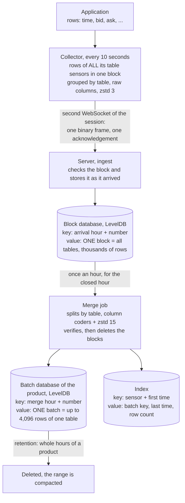
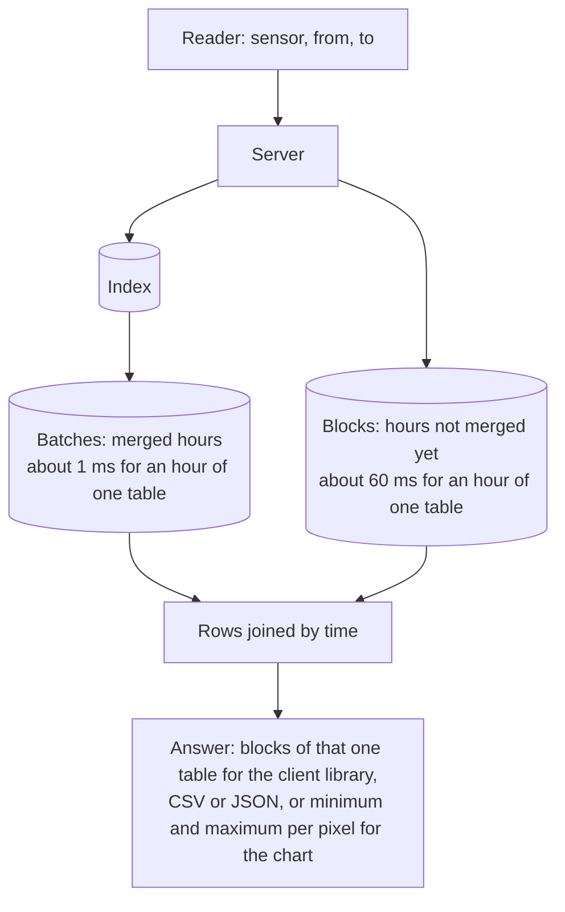

# Initiative: Table sensors — storing matrices in HSM

> Owner: shared | Last reviewed: 2026-11-23 | Status: Decided, see ADR-0021 (`docs/decisions/0021-table-sensors.md`); epic #1842; nothing is built | Canonical: no

## Problem

HSM stores one value at a time. Every value goes through a sensor, alert evaluation and the tree cache, is written as one row, and is compressed only weeks later when its week is sealed (ADR-0020, epic #1800). That fits monitoring: a production server takes about 1.7 million values a day.

It does not fit data that arrives as a dense table. The first case is market data — ticks with bid, ask and sizes — at about 20 GB a day in its present form, which is on the order of hundreds of millions of rows a day, a few hundred times the current load. The same shape appears wherever a client has a matrix rather than a value: rows of measurements with many columns, order books, traces, batches of results.

The owner's requirement (2026-11-20), in priority order:

1. efficient storage of matrices — financial data first, but any multi-column table;
2. sending them to HSM and getting them back;
3. their timely deletion;
4. some rendering, as a nice-to-have.

## Goals

- A client sends a table (a batch of rows with typed columns) as one message; HSM stores it compressed and returns it on request.
- Storage cost close to a column store's, from the moment the data arrives — no uncompressed window.
- The server's work per batch is independent of the number of rows in it.
- Retention by time per sensor, enforced without rewriting data.
- The stored data can be taken out without an HSM library, as CSV or JSON.
- A basic chart of a numeric column over a time range.

## Non-Goals

- Per-row alerts, statuses or comments on table rows. A table sensor can still be watched by ordinary sensors (rows per minute, lag, gaps).
- Editing or deleting individual rows. A range of time can be deleted.
- A query engine (joins, aggregation across sensors). HSM returns the data; analysis happens in the client's tools.
- Replacing ordinary sensors or the sealed history codec of ADR-0020.
- Sub-second delivery of a row to a reader. A row is visible when its batch is.

## Current Behavior

- A value is one of eleven value types; the collector sends values in small packages; the server deserializes each value, runs the sensor model (validation, alerts, last value, aggregation of equal values) and writes one LevelDB row per value: key `sensorId | ticks`, value = MemoryPack bytes, about 130 bytes before LevelDB's own compression.
- File sensors already carry opaque bytes as a value. They are meant for occasional files: a value is one row, is never sealed, and the UI offers it as a download.
- Epic #1800 adds, on the branch `feature/1800-sealed-history`: a chunk database per week (`SensorValuesSealedV1_<from>_<to>`, key `sensorId | firstTick`, value = one compressed chunk of up to 4,096 values of one sensor), reads merged from chunks and rows, range deletes that drop whole chunks and rewrite the ones on the border, and a job that turns closed weeks into chunks. Measured on a production week: 10.6 bytes per value as built, 7.7 with the string and compression changes in progress, against about 160 on disk today.

The chunk database is, in effect, a store of small matrices of one sensor. This initiative lets a client write to such a store directly.

## Proposed Direction

A new kind of sensor, a **table sensor**. Its unit of data is a **batch**: a matrix of rows ordered by time, with a fixed set of typed columns.

```text
client                                  server                                   reader
------                                  ------                                   ------
collect rows into a table
encode by column + compress   --->      check the batch header only:             range query (sensor, from, to)
one message per batch                   schema id, rows, first/last time,   <---
                                        size, checksum                           batches as stored, or merged
                                        store the batch as it is                 a chart: decode + downsample
                                        key: sensorId | firstTime
                                        retention: drop batches older than N
```

Decisions to make, with the leaning of the first draft (2026-11-20). Where this table differs from "Proposal after step 0" below, the proposal is current: the format is HSM's own, not Parquet, and batches live in LevelDB under a key that only grows.

| Question | Leaning | Why / alternative |
|---|---|---|
| Batch format | Parquet, one row group per batch, zstd, sorted by the time column | Readable by Python, DuckDB, ClickHouse; writers exist for .NET, C++, Rust. Alternative: the HSM chunk codec — likely smaller, but only the .NET library reads and writes it, and it knows only HSM's value types. To be measured on real ticks before deciding. |
| Schema | Declared when the sensor is registered: column names and types, the time column, optional key columns; a batch carries the schema's id | The server can validate a batch from its footer without decoding data. Adding a column is a new schema id; old batches keep theirs. |
| More than two dimensions | Key columns (for example instrument, level) or list-typed columns | A matrix of rows and columns covers the first cases; no dedicated N-dimensional type until one is needed. |
| Where batches live | To be measured: values in the weekly chunk LevelDB, or append-only files with a LevelDB index | LevelDB rewrites large values several times during compaction; at a few GB a day that may cost more than it is worth. |
| Small batches | The server may merge the small batches of a closed period into larger ones in the background | Keeps the client simple (send what you have) and the stored files well compressed. Optional in the first version. |
| Retention | Per sensor, by time; a batch is deleted when its last row is older than the limit | No rewrite of border batches: a batch lives until all of it has expired. |
| Reading | A range query returns the batches that overlap the range, as stored; options to trim to the range and to select columns | Returning stored bytes costs the server nothing. Trimming and projection decode on the server and are limited in size. |
| Rendering | Decode the requested range, downsample to the chart's width (min and max per bucket; candles when the schema marks price columns) | "Some rendering", bounded in rows per request. |
| Duplicates and late data | A batch is identified by sensor, first time and a client sequence number; a repeated batch replaces the stored one | Makes a retry after a lost acknowledgement safe. Overlapping batches are returned in time order; the reader merges. |
| Watching the feed | Ordinary sensors derived from batch headers: rows, bytes, lag, gaps between batches | Per-row alerts are a non-goal. |

What it reuses from #1800: the weekly layout and its retention, the chunk-style key, range reads in key order, size accounting, the Configuration page's database list. What is new: the sensor kind and its DTOs, the batch ingest path, the read API, the chart, the collector API.

## Step 0 results (2026-11-23)

Measured with new modes of `src/sandbox/SealedHistoryBench` on the local branch `experiment/table-sensors-step0` (not pushed, not meant for master). The input was a test sample of quote ticks: 440,555 rows, 185 seconds of one busy hour, 1,029 instrument streams, time at 1 ms precision. The sample is private; only counts, sizes and timings are recorded here.

Owner's clarifications of the same day, which fix the shape of the feature:

- The application hands the collector a ready matrix; the collector compresses it and sends it. A large delivery delay is acceptable.
- The description of the matrix (number of columns, names, types) belongs to the sensor and does not change. Another shape (another book depth, prices without volumes) is another sensor. Columns are dense; nulls are not planned.
- Adding a column to an existing sensor is not needed now. A schema id in the batch header keeps it possible later without a format change.

What the sample looks like: 80.6% of rows carry the same timestamp as the previous row and 29.4% are exact duplicates of it, so a format that requires strictly ascending keys (sealed chunk format v1) cannot hold ticks. Prices have 1 to 10 decimal places; every value round-trips as a double bit for bit.

Bytes per row, one table per instrument (the layout the owner chose), batches of 4,096 rows; every configuration round-trips with zero mismatches:

| Codec | time, bid, ask (real data) | + price and volume (price derived, volume synthetic) | Encode, µs per row |
|---|---|---|---|
| Raw columns, 8 bytes per cell | 24.0 | 40.0 | 0.006 |
| Raw columns + zstd 15 | 3.58 | 5.83 | 1.8–2.8 |
| Parquet, library defaults, zstd 3 | 5.50 | 9.59 | 0.14–0.25 |
| Parquet, tuned, prices as scaled integers, zstd 19 | 4.28 | 7.95 | 0.7–1.0 |
| HSM column coders + zstd 3 | — | 5.43 | 0.19 |
| **HSM column coders + zstd 15** | **2.60** | **5.22** | 0.20–0.33 |

For comparison, the same rows are 58 bytes each as log text and 118 as JSON lines. Decoding costs 0.03–0.05 µs per row for the HSM coders. Batch size hardly matters above about 4,096 rows (5.31 bytes at 1,024 rows, 5.21 at any larger size); zstd 19 gains nothing over 15. Parquet wins only in a layout this feature will not use: one table with all instruments interleaved, encoded as a single batch of the whole sample (4.4 bytes against 7.4).

Where the server keeps batches, on scaled data: the sample repeated with shifted timestamps, 4,096-row batches of HSM coders + zstd 15. One day-equivalent is 276 M rows, 67,961 batches, 1.35 GB; seven are 1.93 billion rows, 472,232 batches, 9.46 GB. A batch reaches the store when its last row arrives, so the batches of different instruments interleave and half of them start before the previous one. This is the second run; the first fed batches instrument by instrument and its LevelDB figures (11.1× and 13.7×) are superseded.

The stored size is the same in every variant. They differ in how many bytes the disk takes during ingest, counted by the process write counter until the store is closed:

| Store | Written during ingest, 1 day / 7 days | Real compactions in the LevelDB log, 7 days | Space after deleting the oldest 6 hours, 7 days |
|---|---|---|---|
| LevelDB, key `sensor, first time` | 7.3× / 14.4× | 12,458 (117 GB rewritten) | only after `Compact`: 42 s, 9.2 GB rewritten |
| **LevelDB, key `arrival hour, sequence number`, plus a small index database `sensor, first time` → batch key** | **2.0× / 2.0×** | **0** (2,106 files moved down without rewriting) | only after `Compact`: 0.1 s, 14 MB rewritten |
| LevelDB, key `hour, sensor, first time` | 4.1× / 5.6× | 2,783 (34 GB rewritten) | only after `Compact`: 0.1 s |
| One LevelDB per hour | 2.0× / 1.9× | 2 | at once (the directory is removed) |
| One LevelDB per day | 6.1× / 9.0× | 7,110 (66 GB rewritten) | nothing smaller than a day can go |
| Append-only file per hour + index | 1.0× / 1.0× | — | at once (the file is removed) |

Why the key decides it: LevelDB rewrites a file when its key range overlaps files already below it. Keys that start with the sensor arrive scattered over the whole range, so every new file overlaps. Keys that only grow never overlap, and LevelDB moves such a file down a level by changing metadata. What remains is the write-ahead log plus one table file, which is the 2.0×; LevelDB cannot do less. The index database is 0.12% of the data.

Reads at seven days, warm: one minute of all 1,029 instruments takes 0.19–0.25 s and 22.6 MB in every variant except `hour, sensor, first time` (125 MB read) and one LevelDB per hour (0.49 s, 57 MB); one hour of one instrument takes 0.8–1.2 ms in the LevelDB variants and 3.5 ms from hour files (189 ms the first time after opening). One LevelDB per hour means 226 open databases, 904 handles and 4 s to open them. With 65,536-row batches a minute of all instruments costs 3.1 s and 346 MB (first run), so batches stay small.

No LevelDB variant gives space back by itself within 60 s of a delete; the server has to call `Compact`, which is cheap only with the growing key.

How a time limit on a batch changes the size (2026-11-24, the same sample, HSM coders + zstd 15, a batch closes at the end of its window or at 4,096 rows). "Stored" adds to the coded columns 40 bytes of header and 68 bytes of key and index record per batch; the earlier 2.60 and 5.22 are the coded columns alone, for batches that cover the whole 185 s:

| Window | Batches | Rows per batch, median | Stored, three columns | Stored, five columns |
|---|---|---|---|---|
| 10 s | 18,127 | 14 | 8.67 B/row | 11.88 B/row |
| 30 s | 6,987 | 32 | 5.06 | 7.99 |
| 60 s | 3,999 | 51 | 4.03 | 6.82 |
| 120 s | 2,057 | 114 | 3.33 | 6.02 |
| 185 s (the whole sample) | 1,036 | 229 | 2.86 | 5.47 |

A 60-second limit stores 25% more than the 185-second window with five columns and 41% more with three. At 60 seconds the loss comes mostly from busy tables losing their long batches, not from rare ones: rows in batches of 1,000 or more fall from 39% to 9%. The size was still falling at 185 s; longer windows cannot be measured on this sample. Cut into batches of exactly N rows, five columns cost 16.1 bytes per row at 8 rows, 10.9 at 16, 8.4 at 32, 7.0 at 64 and 6.2 at 128, header included; beyond 128 rows only the busiest tables have full batches, so the curve stops being comparable.

A two-stage variant was measured as well: the collector sends 60-second batches with a cheap encoding (coders + zstd 3: 6.37 bytes per row on the wire with five columns) and the server decodes them and re-encodes each table into batches of up to 4,096 rows. The result is the same 5.47 bytes stored; the server spends about 0.5 µs per row, 133 CPU-seconds a day for 276 M rows on one core, and writes the data a second time.

What the collector sends per tick (2026-11-24, the same sample). Instead of one small batch per table, the rows of all tables in a window can travel as one block. Bytes per row on the wire, a 40-byte header per batch or per block included; on disk a per-table batch adds 68 bytes of key and index record, a block 16 bytes of key:

| Arrival form, 10-second window | Three columns | Five columns | Collector CPU, five columns |
|---|---|---|---|
| One batch per table, HSM coders + zstd 15 | 5.88 (8.67 on disk) | 9.08 (11.88 on disk) | 0.70 µs/row |
| One block, rows grouped by table, HSM coders per table, one zstd 15 frame | 2.69 | 5.26 | 1.00 µs/row |
| One block, rows grouped by table, raw columns, one zstd 15 frame (no HSM coders) | 3.38 | 5.14 | 1.38 µs/row |
| The same with zstd 3 | 3.75 | 5.75 | 0.09 µs/row |
| One block, rows in arrival order with a table-id column, raw columns, zstd 15 | 5.78 | 7.57 | — |

A block is 42–54% smaller on the wire than per-table batches and 56–69% smaller on disk, because the per-batch overhead disappears and one compression frame sees all tables. With five columns the block without HSM coders is as small as the one with them. Grouping the rows by table matters; arrival order with a table-id column is much worse. With 5-second windows the raw block takes 5.65 bytes per row (five columns, zstd 15), with 30-second windows 4.77.

The price is paid by a reader of data that is not merged yet: to get one table out of an hour of 10-second blocks every block is decompressed, 130–260 ms and 207–344 MB for the raw block (50–75 ms and 35–64 MB with coders inside), against 0.1–8 ms and under 1 MB for per-table batches. Splitting a block into per-table rows costs the server 0.02–0.05 µs per row.

LZMA against zstd (SharpCompress 0.30.1, strongest setting the package exposes; a native xz preset was not measured). For per-table batches coded with the HSM coders LZMA changes the size by +1.3% (three columns) and −1.1% (five) and decodes 5–7 times slower; zstd 19 equals zstd 15. On the raw block LZMA does help: 4.06 bytes per row against 5.14 with zstd 15 and 5.75 with zstd 3 (five columns), but encoding costs 9–15 µs per row inside the customer's application against 0.09 for zstd 3, and a read of unmerged data becomes about ten times slower.

Where the column coders lose to plain zstd (2026-11-24, per-column breakdown). On full batches of 4,096 rows with five columns the coders gave 3.59 bytes per row against 3.35 for raw columns under zstd 15, although with three columns they win by 25% (1.03 against 1.38). The loss is one column, the synthetic volume, which the bench draws independently for every row: 2.00 bytes per row with the coders against 1.68 raw. Time, bid, ask and the derived price are each smaller with the coders. The cause is how a coder picks its mode: by the size of its output before zstd. For the volume it picks varints of the differences, which destroys the repeated round values zstd would have found in the raw column. The same rule costs on the real columns too: the bit-packed mode wins before zstd, but varints of the same differences under zstd are 17–32% smaller (time 0.42 against 0.51 bytes per row, bid 0.20 against 0.26). Taking, for every column of a batch, the smaller of the coded and the raw form after zstd gives 3.22 bytes per row at 4,096 rows and 4.99 on the whole sample (against 5.22), and can never be worse than plain zstd. Real volumes are related to their neighbours and may behave differently from the synthetic ones.

One real hour (2026-11-24): one continuous real hour: 2,420,965 rows of 1,093 tables, a median of 102 rows per table, 38% of rows exact duplicates of an earlier row; 672 rows a second on average, 3,591 in the peak second; no gaps (the largest pause of the whole feed is 200 ms). Friday 2026-11-20, 13:00 to 14:00 UTC, quote records only, 331.5 MB of JSON lines. The records carry a real `spread` field, so there are two real shapes. Bytes per row, header, key and index record included:

| Stage | time, bid, ask | time, bid, ask, spread |
|---|---|---|
| Sent by the collector: one block per 10 s, zstd 3 | 3.81 | 4.78 |
| Stored as blocks, no merge | 3.82 | 4.78 |
| Merged once an hour, raw columns + zstd 15 | 2.90 | 3.27 |
| Merged once an hour, column coders + zstd 15 (the codec as it is) | 1.95 | 2.42 |
| Merged, the smaller of coded and raw per column | 1.86 | 2.17 |
| Merged, coder mode chosen after zstd (bench estimate) | 1.53 | 1.80 |

The merge halves the store, and the column coders beat plain zstd by a third on all tables, not only the busiest (on full 1,024-row batches, which cover 89% of the rows: 2.02 against 2.95). The merge period matters: 2.75 bytes per row at 5 minutes, 2.21 at 15, 2.05 at 30, 1.95 at 60 (three columns). One batch per table for the hour with no row cap would give 1.79; one block for the whole hour 2.27. After the hourly merge 37% of the batches hold fewer than 100 rows but only 0.6% of the rows; 66% of the rows sit in full batches of 4,096; 152 of the 1,093 tables fill at least one. Per column, coded against raw under zstd 15: time 1.31 against 2.09, bid 0.21 against 0.36, ask 0.36 against 0.37, spread 0.48 against 0.38 (the coder loses). The ask figure is the work of one placeholder: 1,205 ask cells (0.05% of the rows) hold one constant of at least 1e100, with a zero bid in the same batches, and a single such cell takes the decimal mode away from its whole batch (112 batches, 16% of the rows). Without those rows ask costs what bid does (0.20), and the merged store is 1.78 bytes per row with the codec as it is and 1.45 with the mode chosen after zstd. The source text and the import were checked: no commas, the same distribution of fractional digits for bid and ask, an independent decimal parse agrees for every row, no ratios near 10 or 100 between ask and bid. Storing ask as its difference from bid, or the spread instead of ask, is larger with or without the placeholder rows (1.85 against 1.78), and bid + spread equals ask bit for bit in only 74% of the rows as doubles. Reading one table for the hour: about 60 ms and 58 MB decompressed from blocks, 1.4 ms from batches; all tables for one minute: 2.3 ms from blocks, 35 ms from batches. The merge costs 0.37 µs per row, 0.9 s for the hour. This corrects the three-minute figures above where they differ: the blocks-against-merged comparison there used batches of a median 229 rows and a synthetic volume column.

One real hour of prices with sizes (2026-11-24): the same hour, records of one provider that carry a size next to every price: 2,033,985 records of 944 tables, a median of 175 rows per table, 565 records a second on average, no gaps, 414.5 MB of JSON lines. 99.8% of the records have exactly one book level per side, so the shape is time, bid price, bid size, ask price, ask size; no side is ever empty and there are no placeholders. Prices have up to four digits after the point, two in 830 of the 944 tables; sizes are whole numbers, written in exponent notation in a third of the records. In arrival order 27% of the provider's timestamps go backwards within their table; the measurement sorted the rows by that time. Bytes per row, header, key and index record included:

| Stage | time, bid, ask | time, bid price, bid size, ask price, ask size |
|---|---|---|
| Sent by the collector: one block per 10 s, zstd 3 | 3.85 | 6.73 |
| Stored as blocks, no merge | 3.85 | 6.73 |
| Merged once an hour, raw columns + zstd 15 | 3.02 | 5.01 |
| Merged once an hour, column coders + zstd 15 (the codec as it is) | 2.14 | 4.07 |
| Merged, the smaller of coded and raw per column | 2.15 | 3.97 |
| Merged, coder mode chosen after zstd (bench estimate) | 1.79 | 3.48 |

Per column after the merge, coded against raw under zstd 15: time 1.74 against 2.38, bid price 0.17 against 0.28, ask price 0.16 against 0.27, bid size 0.95 against 0.95, ask size 0.95 against 0.95. The coders gain nothing on the sizes, and the time is the largest column. Merge period, five columns: 4.97 bytes per row at 5 minutes, 4.39 at 15, 4.19 at 30, 4.07 at 60. Reading one table for the hour: 83–112 ms from blocks, 2.8 ms from batches; all tables for one minute: 3.1 ms from blocks, 66 ms from batches. The merge costs 0.54 µs per row, 1.1 s for the hour. At this hour's rate (48 M rows a day) a year is 118 GB as blocks and 71 GB merged.

Client side, from package metadata and code reading: the last Parquet.Net release with a `netstandard2.0` target is 5.5.0 (later releases need net8.0) and it brings System.Text.Json 10 into net472 consumers; a C++ Parquet writer means Apache Arrow through vcpkg (OpenSSL, Thrift, Boost and more; no 32-bit x86), where the native collector depends only on curl today. The HSM integer and double coders are about 840 lines, need four trivial polyfills for net472, and ZstdSharp.Port supports net472; zstd itself is a single small vcpkg port.

Not measured: more than three minutes of real data; real price and volume columns; Linux (the run was on Windows); cold-disk reads; the collector on .NET Framework; delivery delay; whether LevelDB frees deleted space by itself after more than 60 s; batches that arrive hours late (the growing key takes them at the end by construction, which was reasoned and not run).

## Decision (2026-11-24)

ADR-0021 is the decision and is authoritative. In short, as accepted by the owner after the measurements above; nothing is built yet.

| Question | Decision |
|---|---|
| Who packs | Two packers. The collector packs simply and cheaply for transport; the server packs for storage. No HSM column coders in the collectors. |
| What the collector sends | Every 10 seconds one block with the rows of all its table sensors, grouped by table, raw columns under one zstd 3 frame: 3.8 bytes per row for time, bid and ask on the real hour, at about 0.1 µs of CPU per row. On stop the open block goes at once; undelivered blocks wait in a local file. |
| Transport | A second WebSocket connection of the collector session, binary frames, one acknowledgement per block. |
| Ingest | The server checks the block and stores it as it arrived, in LevelDB under the key `arrival hour, sequence number`. Rows are readable at once. |
| Merge | Once an hour the server packs the blocks of the closed hour into batches of up to 4,096 rows per table (column coders of sealed history, zstd 15), verifies them and deletes the blocks. One merge, no cascade. |
| Where batches live | LevelDB, one database per product, key `merge hour, sequence number`, plus an index `sensor, first time`. |
| Deletion | One retention period per product: a range delete of whole hours, then a compaction of that range. |
| Read API | A range request returns rows as blocks of one table, from batches and from blocks not merged yet; the client library returns a matrix; CSV or JSON for clients without it. |
| Rendering | Minimum and maximum per pixel column, computed by the server. |
| LZMA | Not used: about one percent after the column coders, and too slow inside the collector. |

## The decision in pictures

The way of a row from the application to the disk:



How a read is answered:



The life of a row: up to 10 seconds in the collector; then in a block until its hour is merged (3.8 bytes per row for time, bid, ask on the real hour; readable at once, a read of one table is slow); then in a batch until retention (1.95 bytes per row, a read is fast).

## Open questions

For the owner:

- The exact columns of the first sensors. Measured on real data so far: time, bid, ask; and time, bid price, bid size, ask price, ask size from one provider. Book levels beyond the first were too rare in that hour (0.2% of the records) to measure.
- Which time a row carries and in what order rows come. In the measured feed 27% of the provider's timestamps go backwards within a table in arrival order; the measurement sorted the rows, while a table sensor keeps the order the application gives.
- The retention period for tick data: about 69 GB a year for time, bid, ask at 97 M rows a day, and about 71 GB a year for the five real columns at the measured 48 M rows a day.
- Three choices in ADR-0021 were made without a discussion: a read returns blocks, so the storage coders live only in the server; one batch database per product; tables need the session transport, there is no HTTP route for sending.

To be settled inside the steps:

- How a table is named in the directory of a block, and what exactly happens to a block with a refused table (#1843, #1844).
- One block database, or one per week or month (#1844).
- How the limits on sessions per address count the second connection (#1845).
- How the encoding of a column is chosen by its size after zstd without compressing every candidate (#1850).
- How an older client library reads what a newer server answers (#1845).

Not measured yet:

- Linux; more than one hour, quieter hours and more than one provider; rows in arrival order with timestamps that go backwards; book levels beyond the first; cold-disk reads; the collector on .NET Framework; binary session frames through libcurl; blocks that arrive hours late.

## Capacity

Stored size is measured on the test sample; the row counts of the future product are not known.

| Quantity | Value | Basis |
|---|---|---|
| Stored size | time, bid, ask: 3.8 bytes per row in blocks, 1.95–2.14 after the hourly merge; time, bid price, bid size, ask price, ask size: 6.7 and 4.1 | two real hours; header, key and index record included |
| A billion rows | 2 GB after the merge with three real columns, 4 GB with five | the same |
| Test feed, quotes only (about 97 M rows a day), three real columns | 0.19 GB a day, 5.7 GB a month, 69 GB a year after the merge; 135 GB a year if kept as blocks | arithmetic on the real hour; the measured hour itself ran at 58 M rows a day |
| Test feed, every record of the ticks file (276 M rows a day) | not established | the earlier 525 GB a year assumed five columns, two of them synthetic; 65% of those records are not quotes and their real columns were not measured |
| A sustained 10,000 rows a second, three real columns | 1.7 GB a day, 51 GB a month, 615 GB a year | arithmetic |
| Free disk on production | about 550 GB | checked 2026-11-19 |
| Server work | on ingest: checksum, decompression and directory check of one block per collector per tick; once an hour the merge, about 0.5 µs per row | each row reaches the disk four times (twice in its block, twice in its batch) |

## Work Breakdown

| Step | Scope | Notes |
|---|---|---|
| 0 | Measure on one real day of ticks: row count, instruments, Parquet (zstd) against the HSM chunk codec against the present form; batch size against compression and read time; LevelDB values against files | Done 2026-11-23, see the results above. |
| — | ADR-0021: the table sensor, the batch format, the schema rules, storage, retention, what the server validates | Done 2026-11-23. |
| 1 | #1843 Block format library, shared by the server and the managed collector | The only table format outside the server. |
| 2 | #1844 Server: sensor kind, schema and the block store | Storage key formats are compatibility-sensitive. |
| 3 | #1845 Server: the table connection of the session and the range read API | The session protocol and the DTOs in `HSMSensorDataObjects` are compatibility-sensitive. |
| 4 | #1846 Managed collector: a table sensor API that gathers rows and sends one block per tick | Public API of a library used by third parties: additive only. |
| 5 | #1847 Chart of a numeric column; feed sensors from block directories | |
| 6 | #1848 Native collector | A block writer and zstd; no port of the column coders. Conformance coverage for both collectors is required by the project rules. |
| 7 | #1849 Rollout: a test deployment under the target volume, Linux, the disk decision | |
| 8 | #1850 Server: stored batches, the hourly merge and retention | Follows step 2. Needs the same care as the sealing job of ADR-0020: verify before delete, safe at any crash point. |

## Risks

- **Scope of HSM.** This makes HSM a store of bulk data as well as a monitoring system. Disk, backup and upgrade planning change with the volume; sensor history is not part of the server's backups today.
- **Disk.** A year of ticks does not fit on the current production disk. Retention or more storage has to be decided before the feature is switched on.
- **Compatibility.** A new sensor type reaches the shared DTOs and the public collector API. Older collectors and servers must ignore or refuse it cleanly.
- **Two formats.** The block is a public format that both collectors write; the batch is a storage format next to the sealed-history chunk. Each needs its own limits and versioning, and both have to stay readable forever.
- **Large values in LevelDB.** Measured in step 0: the cost depends on the key. A sensor-first key rewrites the data 14 times at seven days; a key that only grows writes it twice. The batch database must therefore never take keys out of order, and must not share a database with sensor values.
- **Untrusted input.** A batch is client-supplied bytes that the server later decodes for charts and trimmed reads: limits on rows, columns, decoded size and nesting are part of the format rules, and they are checked before any column is decoded. The column coders are the ones sealed history already uses; zstd comes from a maintained library.
- **Native collector.** It writes blocks with zstd from vcpkg and opens a second session connection with binary frames through libcurl, which the project has not used before.

## Verification

- Step 0 produces numbers on real data and is recorded here.
- Round trip: what a client sends is what a reader gets, byte for byte, for every batch.
- Retention removes exactly the expired batches; a restart in the middle loses and resurrects nothing.
- Ingest and read under the target volume on a test deployment: server CPU and memory, disk growth, read latency of a one-hour range.
- A batch that fails validation is refused with a reason and is counted; it never becomes a partly stored table.
- Docs: `aicontext/features/` for the feature, the glossary term, the wiki page for operators, the collector's public documentation.
